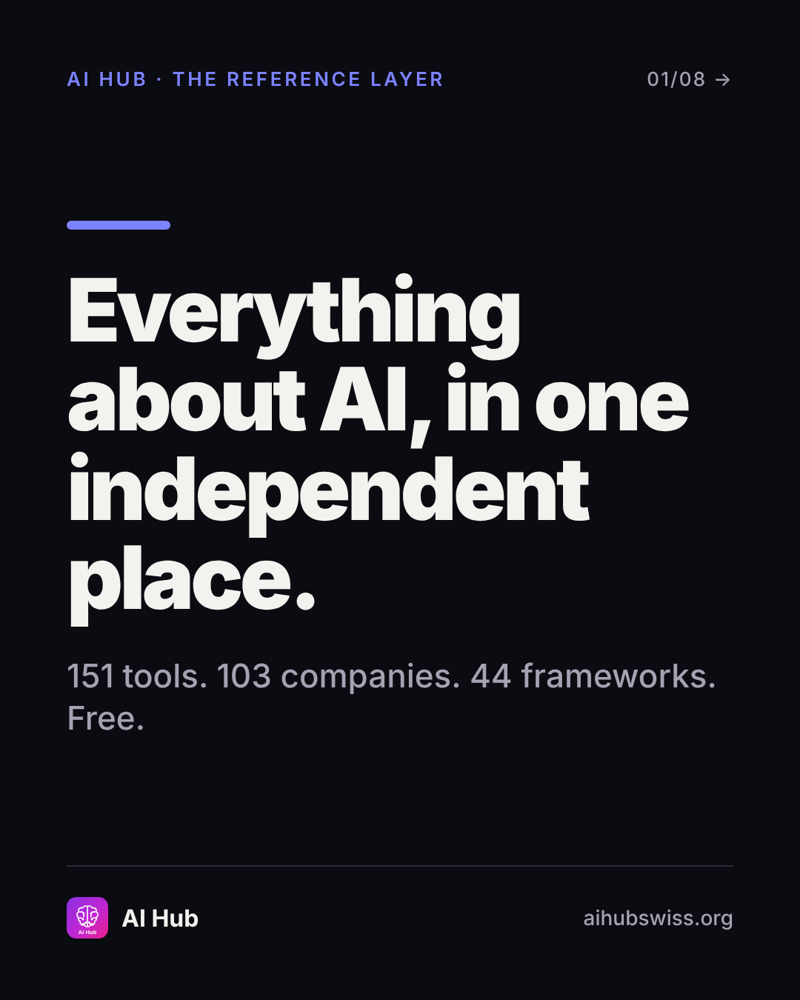
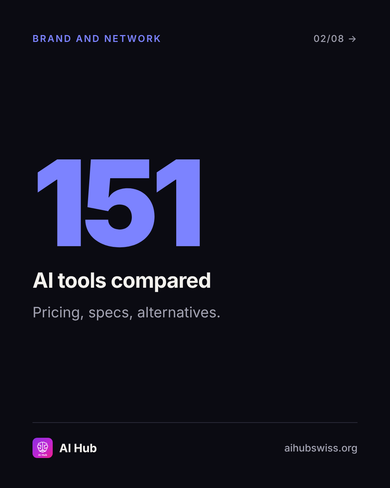
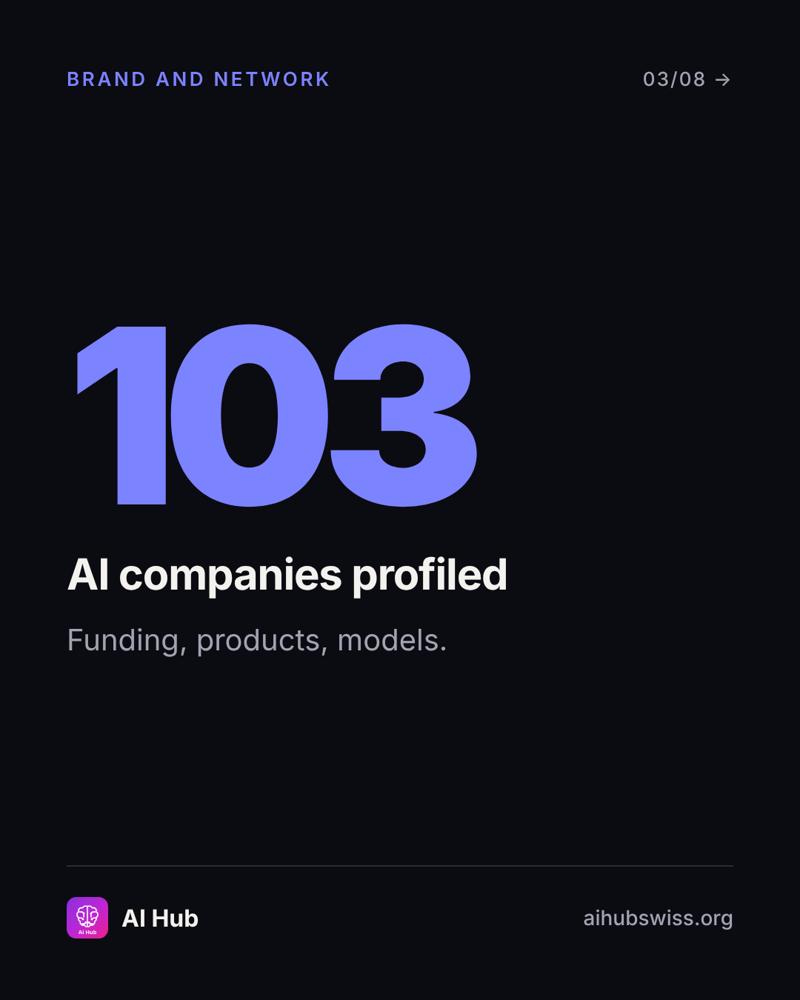
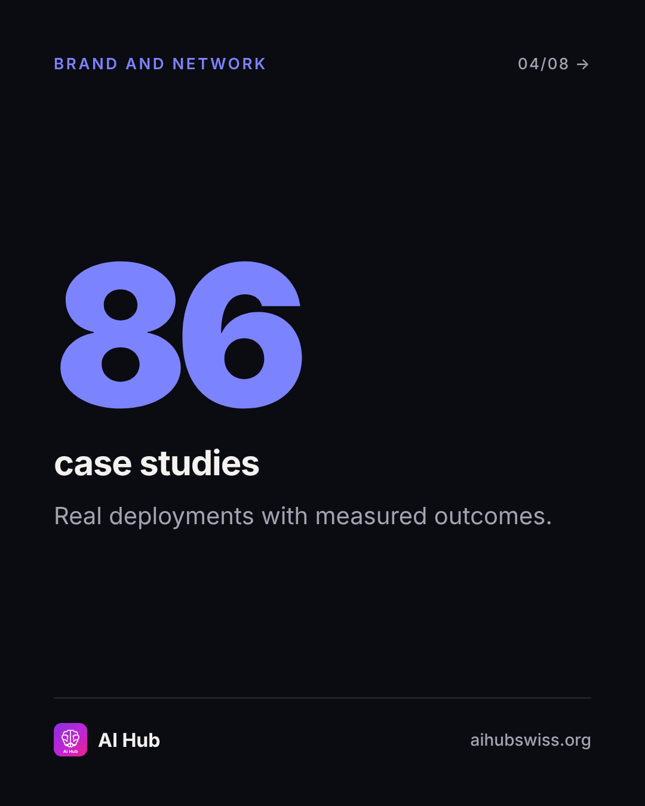
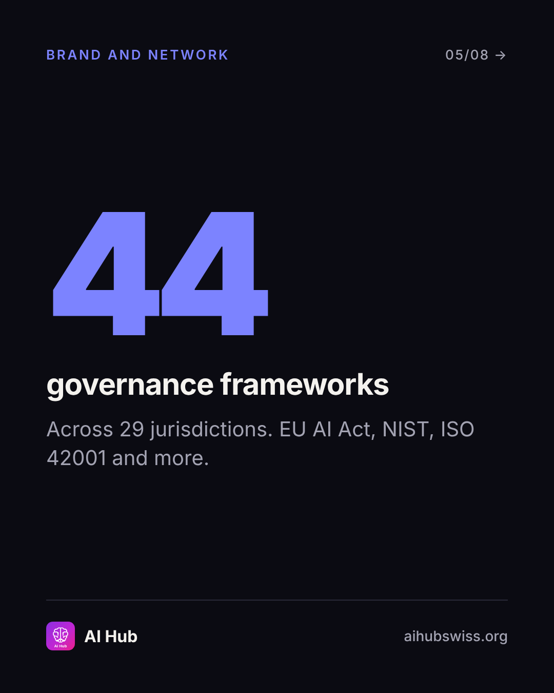
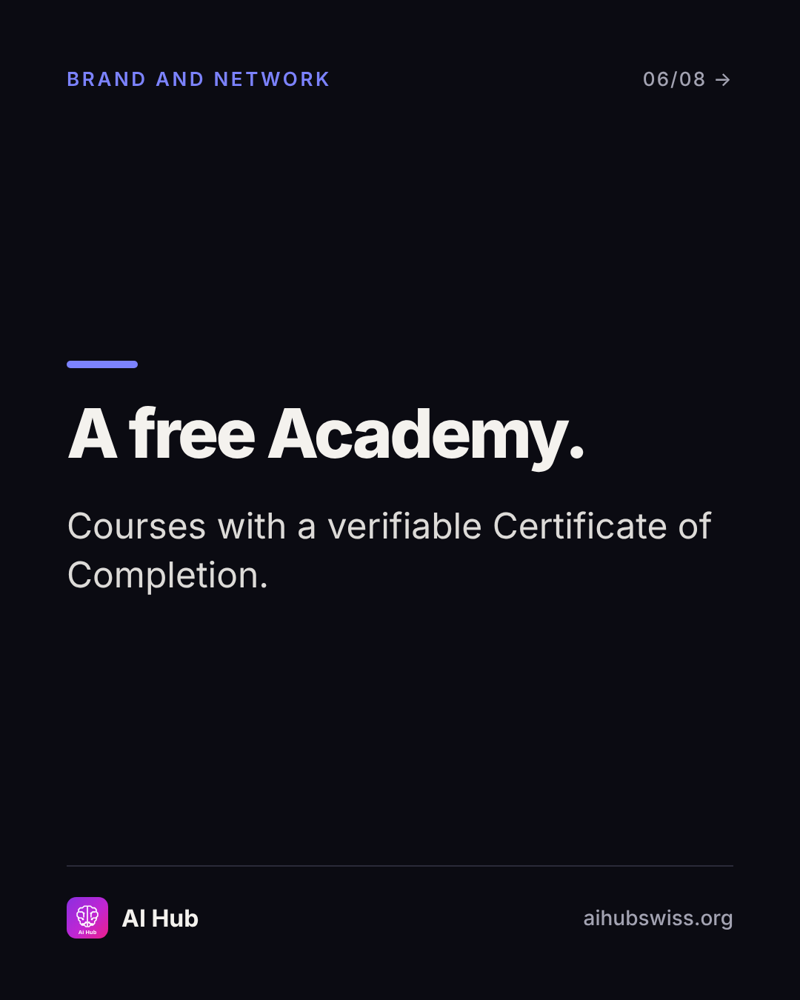
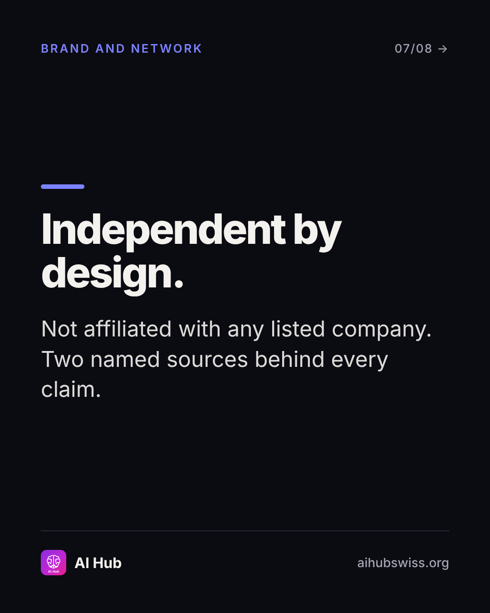
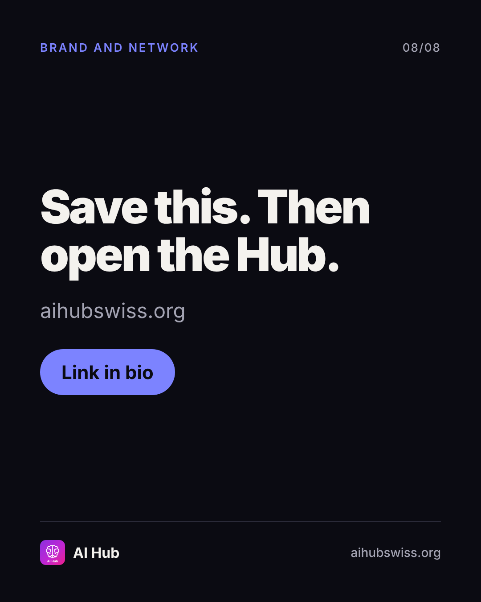

<!-- Generated by design/build-docs.mjs from content/posts.json. Edit the JSON, not this file. -->
# D01 · Wed, 4 Nov 2026 · 12:30 CET: Launch: the reference layer

| | |
|---|---|
| Phase | 1 Establish |
| Pillar | Brand and network (indigo #7C83FF) |
| Format | carousel |
| Goal | Introduce AI Hub with proof, drive saves and profile follows |
| Primary action | save |
| DM keyword | `HUB` |
| Tracked link | https://aihubswiss.org/?utm_source=instagram&utm_medium=social&utm_campaign=hub-nov26&utm_content=d01-carousel |

## Hook
Most AI information is written by someone selling you something. This isn't.

## Slides (8), 1080×1350
1. **cover**: AI HUB · THE REFERENCE LAYER | Everything about AI, in one independent place. | 151 tools. 103 companies. 44 frameworks. Free.  
   
2. **stat**: 151 AI tools compared | Pricing, specs, alternatives.  
   
3. **stat**: 103 AI companies profiled | Funding, products, models.  
   
4. **stat**: 86 case studies | Real deployments with measured outcomes.  
   
5. **stat**: 44 governance frameworks | Across 29 jurisdictions. EU AI Act, NIST, ISO 42001 and more.  
   
6. **point**: A free Academy. | Courses with a verifiable Certificate of Completion.  
   
7. **point**: Independent by design. | Not affiliated with any listed company. Two named sources behind every claim.  
   
8. **cta**: Save this. Then open the Hub. | aihubswiss.org | Link in bio  
   

## Caption
First line is 76 characters (shows before "…more", keep it under ~125).

```text
Most AI information is written by someone selling you something. This isn't.

AI Hub is an independent reference for the AI landscape, hand-verified and updated daily:

• 151 AI tools, compared
• 103 companies, profiled
• 86 case studies with measured outcomes
• 44 governance and compliance frameworks
• A free Academy with a verifiable certificate

Independent and vendor-neutral, not affiliated with any listed company. Start where you are: tools, regulation, or learning.

Save this for the next time someone asks you "which AI should we use?"

Link in bio.
```

## First comment (post within 1 minute)
```text
Which one do you need most right now: tools, regulation or learning? Tell me and I'll point you to the right page.
```

## Hashtags
#AIGovernance #AITools #ResponsibleAI #EUAIAct  
Put them at the end of the caption or in the first comment. Keep to 3 to 5.

## Alt text
Carousel introducing AI Hub: 151 tools, 103 companies, 86 case studies and 44 governance frameworks, free and independent.

## Call to action
- Primary: save. Link in bio points to today's tracked link above (also set the Story link sticker).
- DM keyword `HUB`: reply with the tracked link.

## Story follow-up (same day)
Poll: What do you want from an AI reference? (Tools / Regulation / Learning). Link sticker to home.

## Facts used and where they come from
- `ai-hub/src/data/site-counts.ts`
- `ai-hub/src/app/llms.txt/route.ts`
