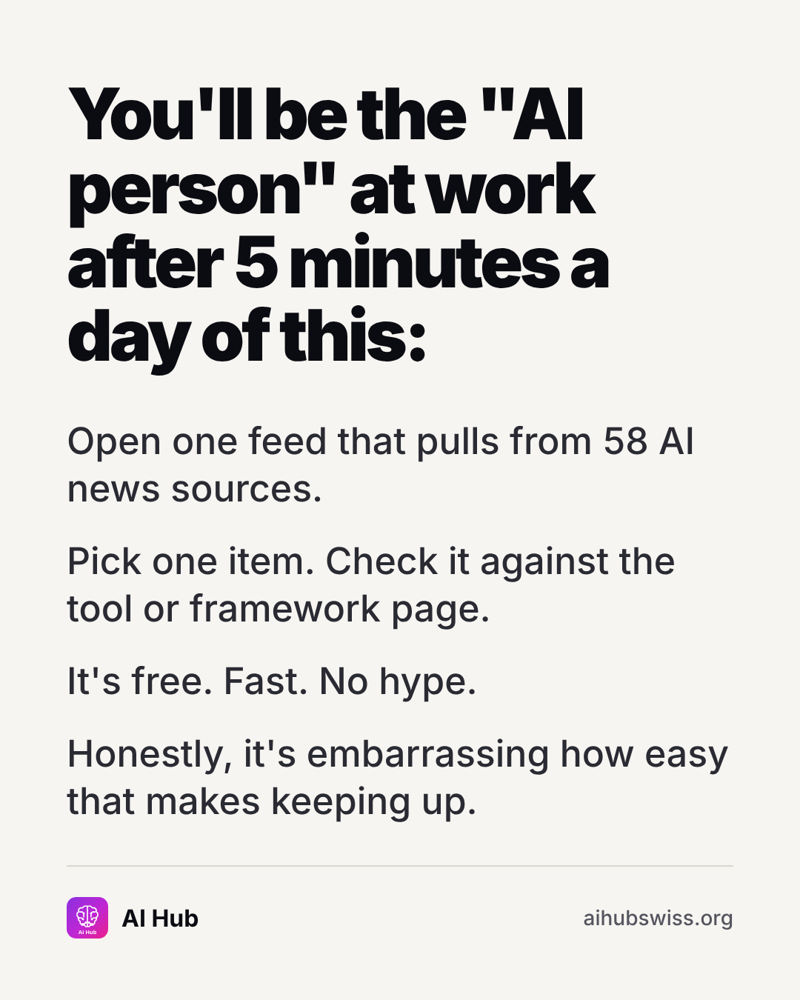

<!-- Generated by design/build-docs.mjs from content/posts.json. Edit the JSON, not this file. -->
# D02 · Thu, 5 Nov 2026 · 18:30 CET: The 5-minute habit (text card)

| | |
|---|---|
| Phase | 1 Establish |
| Pillar | Tools and learning (teal #2DD4BF) |
| Format | textcard |
| Goal | Relatable, shareable identity post (sends) |
| Primary action | send |
| DM keyword | `NEWS` |
| Tracked link | https://aihubswiss.org/news?utm_source=instagram&utm_medium=social&utm_campaign=hub-nov26&utm_content=d02-textcard |

## Hook
You'll be the "AI person" at work after 5 minutes a day of this.

## Slides (1), 1080×1350
1. **text**: You'll be the "AI person" at work after 5 minutes a day of this: | Open one feed that pulls from 58 AI news sources. / Pick one item. Check it against the tool or framework page. / It's free. Fast. No hype. / Honestly, it's embarrassing how easy that makes keeping up.  
   

## Caption
First line is 101 characters (shows before "…more", keep it under ~125).

```text
Keeping up with AI doesn't need a new job title. It needs a 5-minute habit and sources you can trust.

AI Hub's news feed pulls from 58 sources across research, industry and policy. Pick one story, then check it against the tool, company or framework page it touches.

Send this to the colleague who keeps asking "did you see what happened in AI this week?"

Link in bio.
```

## First comment (post within 1 minute)
```text
What's your current way of keeping up with AI news? Newsletter, feed, or group chat?
```

## Hashtags
#AINews #AILiteracy #AITools  
Put them at the end of the caption or in the first comment. Keep to 3 to 5.

## Alt text
Text post: You'll be the AI person at work after 5 minutes a day: one feed, 58 sources, free.

## Call to action
- Primary: send. Link in bio points to today's tracked link above (also set the Story link sticker).
- DM keyword `NEWS`: reply with the tracked link.

## Story follow-up (same day)
Question sticker: How do you keep up with AI today? Reshare answers (with permission).

## Facts used and where they come from
- `ai-hub/src/data/site-counts.ts (newsSources: 58)`
- `ai-hub/src/app/llms.txt/route.ts`
