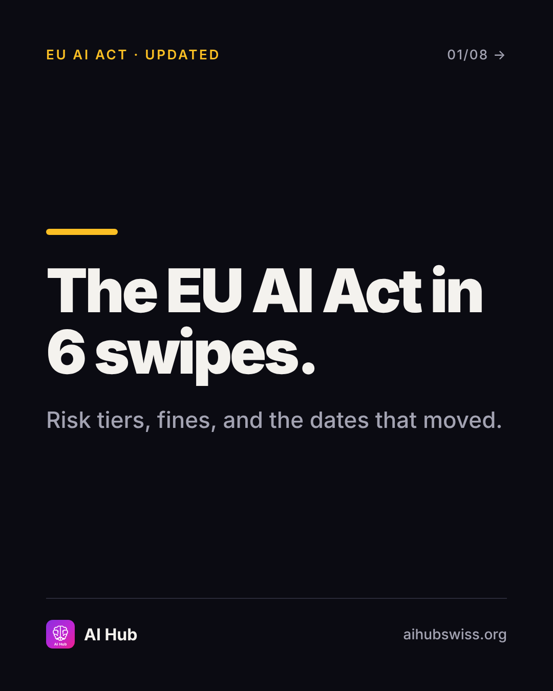
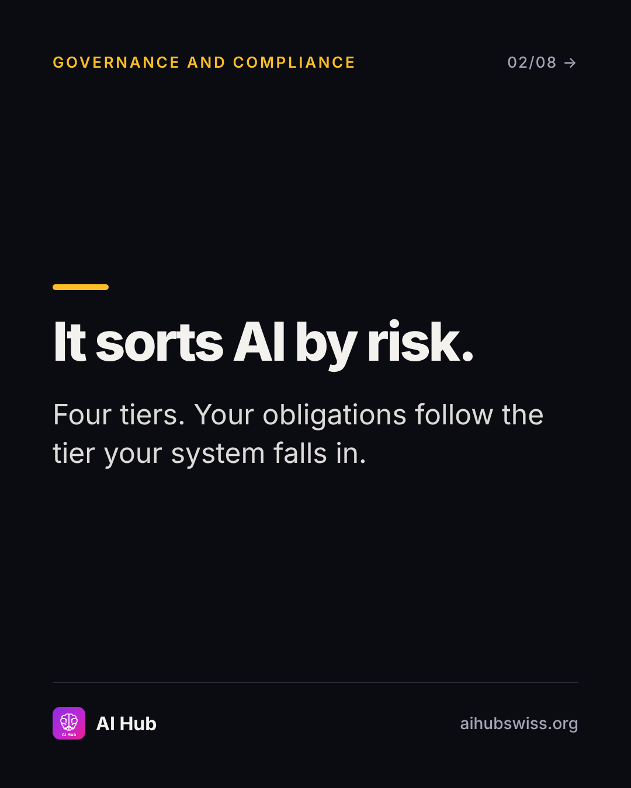
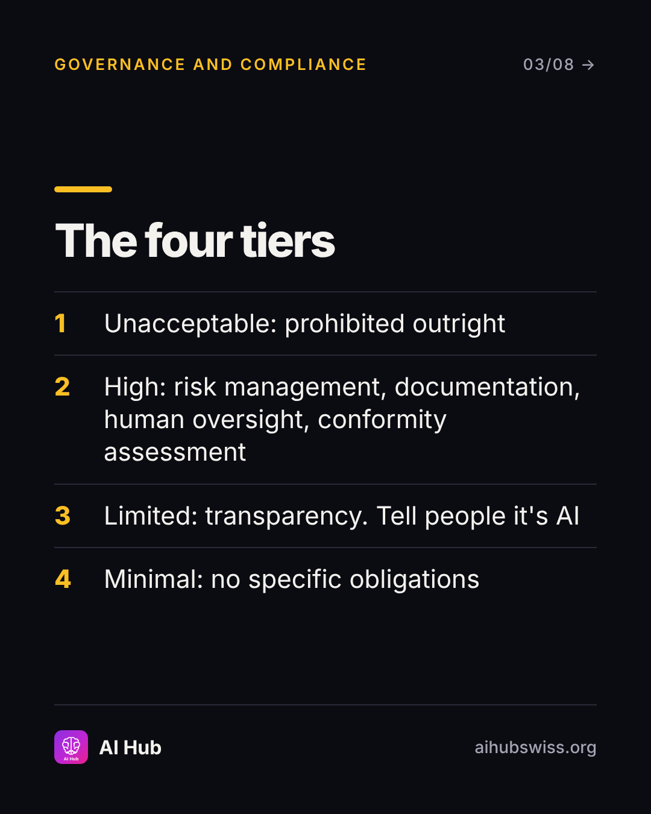
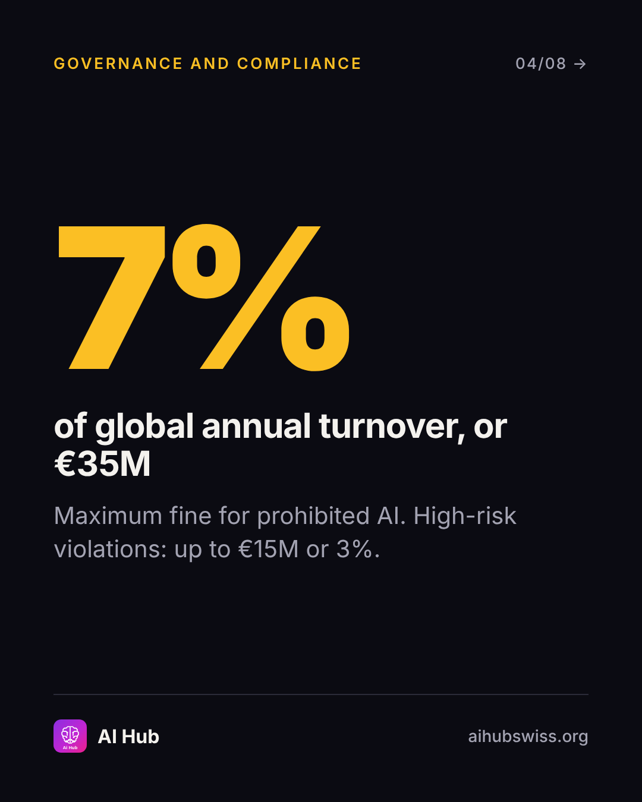
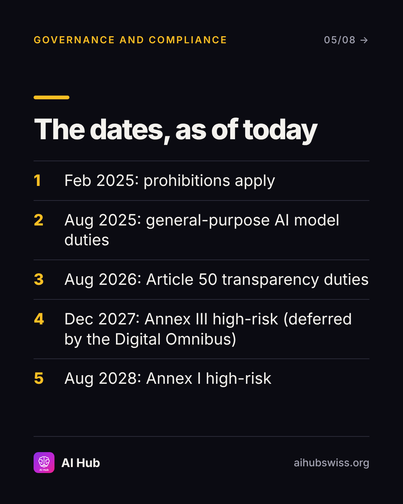
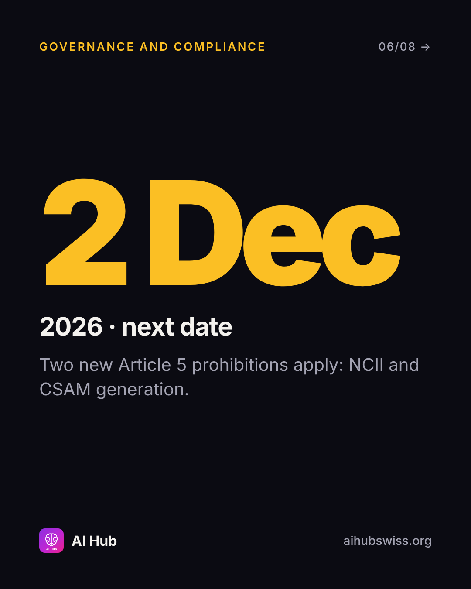
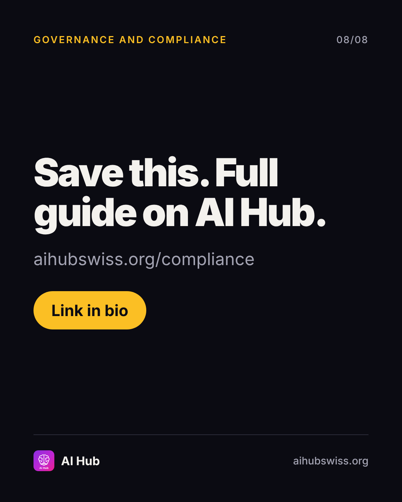

<!-- Generated by design/build-docs.mjs from content/posts.json. Edit the JSON, not this file. -->
# D04 · Sat, 7 Nov 2026 · 10:00 CET: EU AI Act in 6 swipes

| | |
|---|---|
| Phase | 1 Establish |
| Pillar | Governance and compliance (amber #FBBF24) |
| Format | carousel |
| Goal | Saves and authority; time-sensitive governance hook |
| Primary action | save |
| DM keyword | `EUAI` |
| Tracked link | https://aihubswiss.org/compliance/eu-ai-act?utm_source=instagram&utm_medium=social&utm_campaign=hub-nov26&utm_content=d04-carousel |

> **Before posting:** Re-check the compliance.ts timeline on the morning of posting; the site's llms.txt still says high-risk applies from Aug 2026 and is out of step.

## Hook
The EU AI Act dates just moved. Here's the version that's current.

## Slides (8), 1080×1350
1. **cover**: EU AI ACT · UPDATED | The EU AI Act in 6 swipes. | Risk tiers, fines, and the dates that moved.  
   
2. **point**: It sorts AI by risk. | Four tiers. Your obligations follow the tier your system falls in.  
   
3. **list**: The four tiers | 1) Unacceptable: prohibited outright / 2) High: risk management, documentation, human oversight, conformity assessment / 3) Limited: transparency. Tell people it's AI / 4) Minimal: no specific obligations  
   
4. **stat**: 7% of global annual turnover, or €35M | Maximum fine for prohibited AI. High-risk violations: up to €15M or 3%.  
   
5. **list**: The dates, as of today | 1) Feb 2025: prohibitions apply / 2) Aug 2025: general-purpose AI model duties / 3) Aug 2026: Article 50 transparency duties / 4) Dec 2027: Annex III high-risk (deferred by the Digital Omnibus) / 5) Aug 2028: Annex I high-risk  
   
6. **stat**: 2 Dec 2026 · next date | Two new Article 5 prohibitions apply: NCII and CSAM generation.  
   
7. **point**: Who it covers. | Anyone placing AI on the EU market or putting it into service in the EU, including non-EU companies serving EU users.  
   
8. **cta**: Save this. Full guide on AI Hub. | aihubswiss.org/compliance | Link in bio  
   

## Caption
First line is 84 characters (shows before "…more", keep it under ~125).

```text
The EU AI Act deadlines moved, and a lot of what's still circulating is out of date.

As of today: prohibitions have applied since Feb 2025, general-purpose AI duties since Aug 2025, Article 50 transparency duties since Aug 2026. The Digital Omnibus deferred standalone high-risk (Annex III) obligations to Dec 2027. Next date on the calendar: 2 December 2026.

Swipe for the risk tiers, the fines and who it covers. Save it for your next governance meeting.

General information, not legal advice. Check the Act and your counsel for your situation.

Link in bio.
```

## First comment (post within 1 minute)
```text
Comment EUAI and I'll send you the full guide with the timeline and checklist.
```

## Hashtags
#EUAIAct #AIGovernance #AICompliance #ResponsibleAI  
Put them at the end of the caption or in the first comment. Keep to 3 to 5.

## Alt text
Carousel: the EU AI Act risk tiers, penalties up to 7% of turnover, and the updated timeline including the Digital Omnibus deferral.

## Call to action
- Primary: save. Link in bio points to today's tracked link above (also set the Story link sticker).
- DM keyword `EUAI`: reply with the tracked link.

## Story follow-up (same day)
Countdown sticker to 2 Dec 2026 (new Article 5 prohibitions). Link sticker to the guide.

## Facts used and where they come from
- `ai-hub/src/data/compliance.ts (EU AI Act timeline, penalties, affectedOrgs)`
