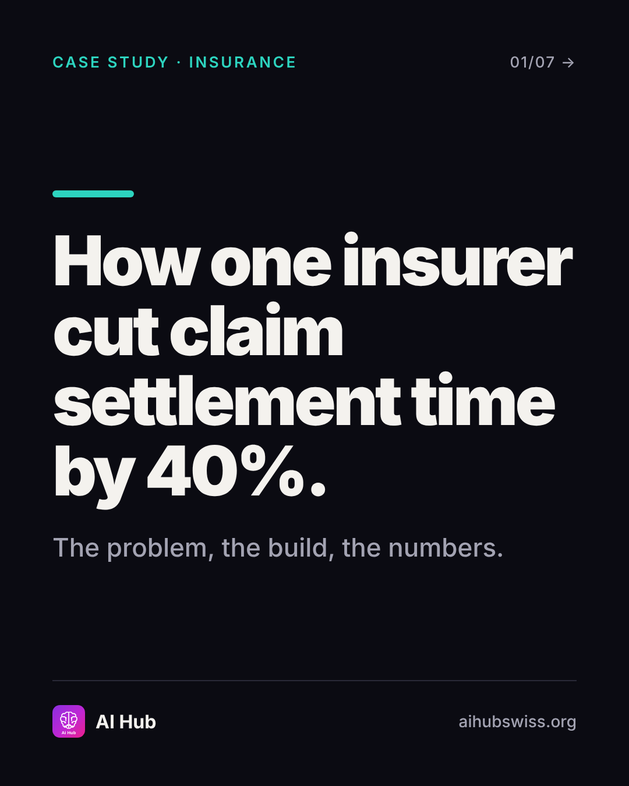
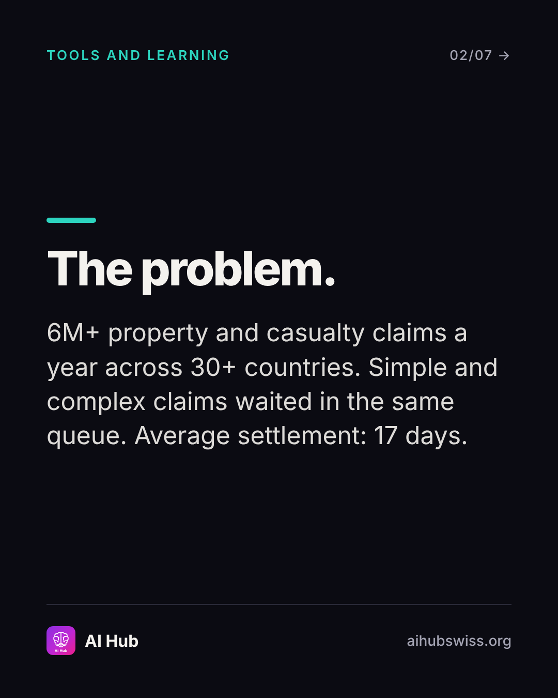
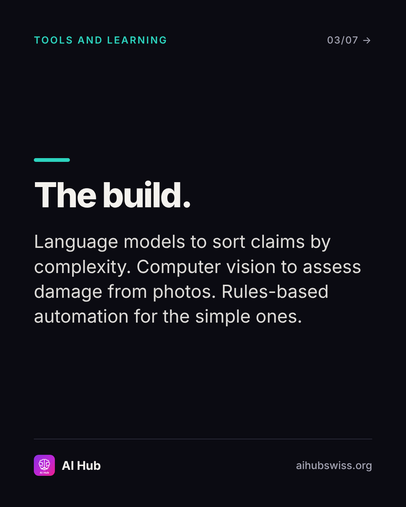
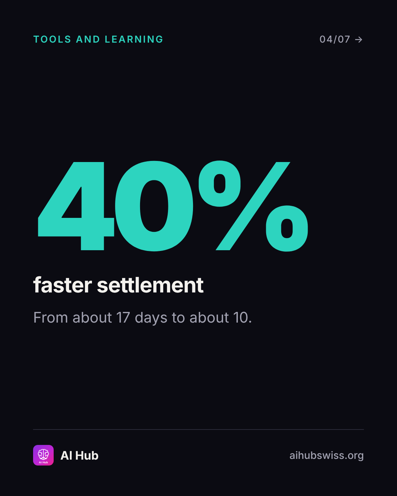
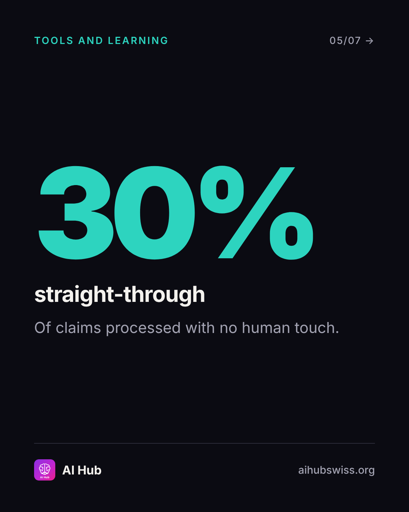
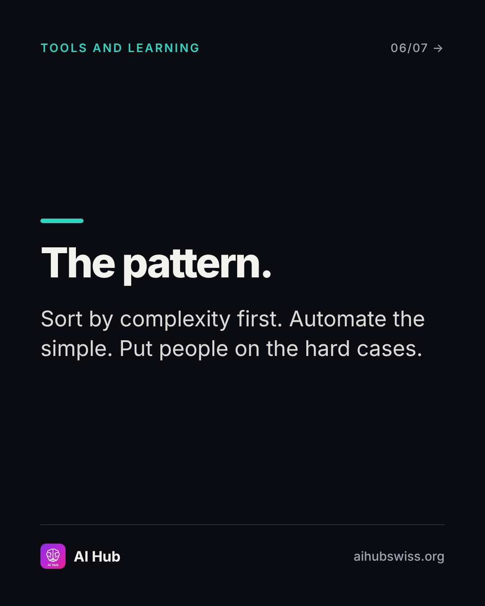
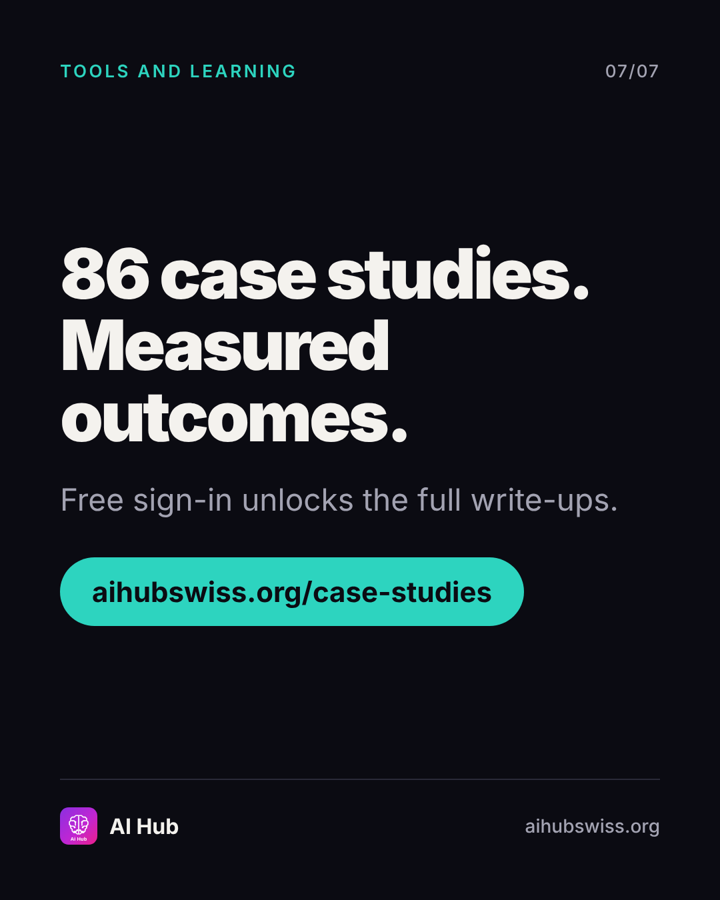

<!-- Generated by design/build-docs.mjs from content/posts.json. Edit the JSON, not this file. -->
# D05 · Sun, 8 Nov 2026 · 18:00 CET: Case study: claims triage

| | |
|---|---|
| Phase | 1 Establish |
| Pillar | Tools and learning (teal #2DD4BF) |
| Format | carousel |
| Goal | Proof post; drive free sign-ins to read full case studies |
| Primary action | save |
| DM keyword | `CASES` |
| Tracked link | https://aihubswiss.org/case-studies/zurich-claims-ai?utm_source=instagram&utm_medium=social&utm_campaign=hub-nov26&utm_content=d05-carousel |

> **Before posting:** Use the entry's figures as 'reported'. Do not add any link to your employer or imply one; AI Hub content stays independent.

## Hook
How one insurer cut claim settlement time by 40%.

## Slides (7), 1080×1350
1. **cover**: CASE STUDY · INSURANCE | How one insurer cut claim settlement time by 40%. | The problem, the build, the numbers.  
   
2. **point**: The problem. | 6M+ property and casualty claims a year across 30+ countries. Simple and complex claims waited in the same queue. Average settlement: 17 days.  
   
3. **point**: The build. | Language models to sort claims by complexity. Computer vision to assess damage from photos. Rules-based automation for the simple ones.  
   
4. **stat**: 40% faster settlement | From about 17 days to about 10.  
   
5. **stat**: 30% straight-through | Of claims processed with no human touch.  
   
6. **point**: The pattern. | Sort by complexity first. Automate the simple. Put people on the hard cases.  
   
7. **cta**: 86 case studies. Measured outcomes. | Free sign-in unlocks the full write-ups. | aihubswiss.org/case-studies  
   

## Caption
First line is 59 characters (shows before "…more", keep it under ~125).

```text
A claim doesn't need an adjuster just because it's a claim.

This AI Hub case study follows an insurer that sorted claims by complexity, assessed damage from photos and straight-through processed the simple ones. Reported results: settlement time down about 40%, with 30% of claims handled with no human touch.

Figures are as reported in the case study entry. The full write-up covers the context, tech stack and lessons.

There are 86 case studies on AI Hub, each with measured outcomes. Free sign-in unlocks them.

Save this if your team is scoping an automation pilot.

Link in bio.
```

## First comment (post within 1 minute)
```text
Which function would you triage first in your organisation: claims, support tickets, or contracts?
```

## Hashtags
#AIinInsurance #InsurTech #AICaseStudy #Automation  
Put them at the end of the caption or in the first comment. Keep to 3 to 5.

## Alt text
Carousel summarising an insurance AI case study: claims triage, 40% faster settlement, 30% straight-through processing.

## Call to action
- Primary: save. Link in bio points to today's tracked link above (also set the Story link sticker).
- DM keyword `CASES`: reply with the tracked link.

## Story follow-up (same day)
Slider sticker: How much of your team's work could be triaged by complexity? Link sticker to case studies.

## Facts used and where they come from
- `ai-hub/src/data/case-studies-data-insurance.ts (id: zurich-claims-ai)`
