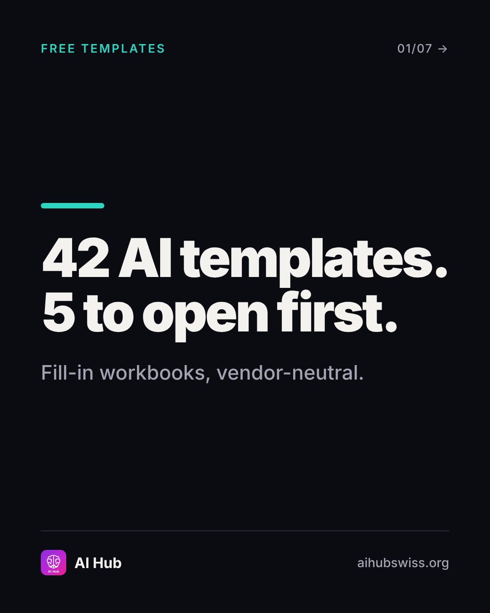
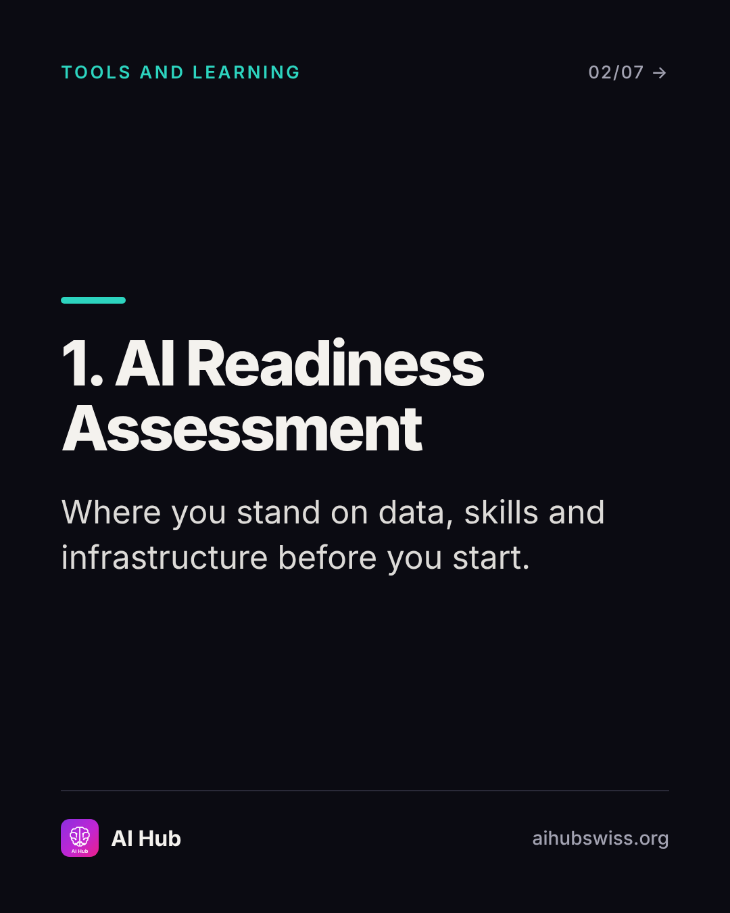
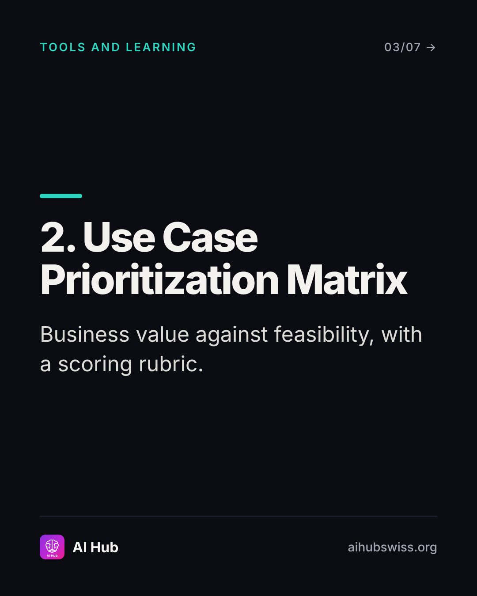
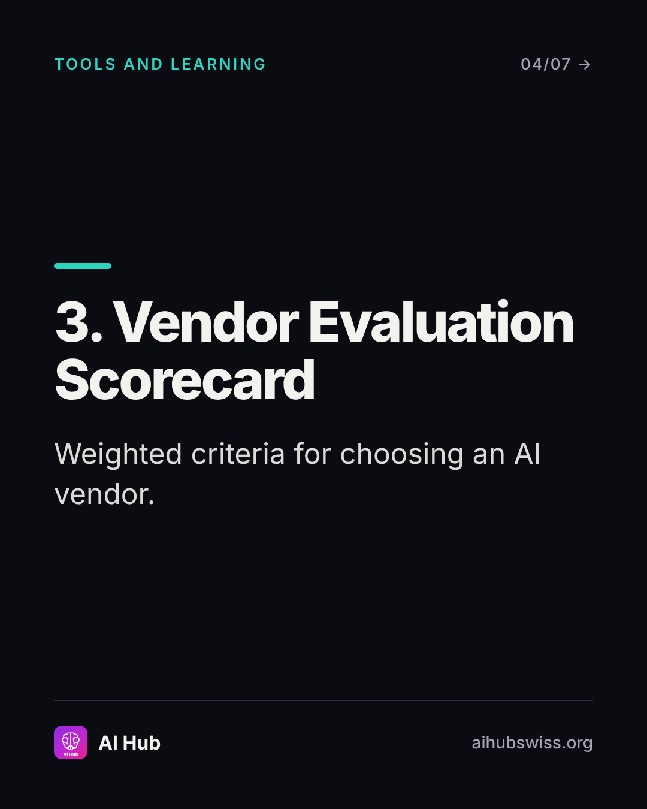
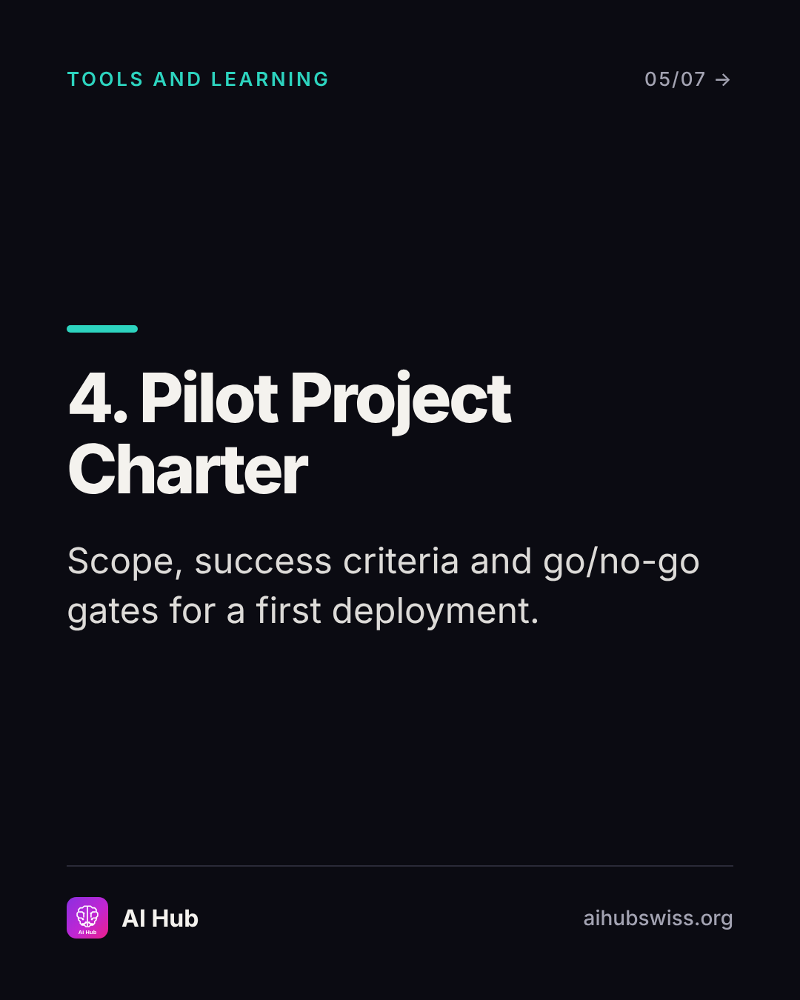
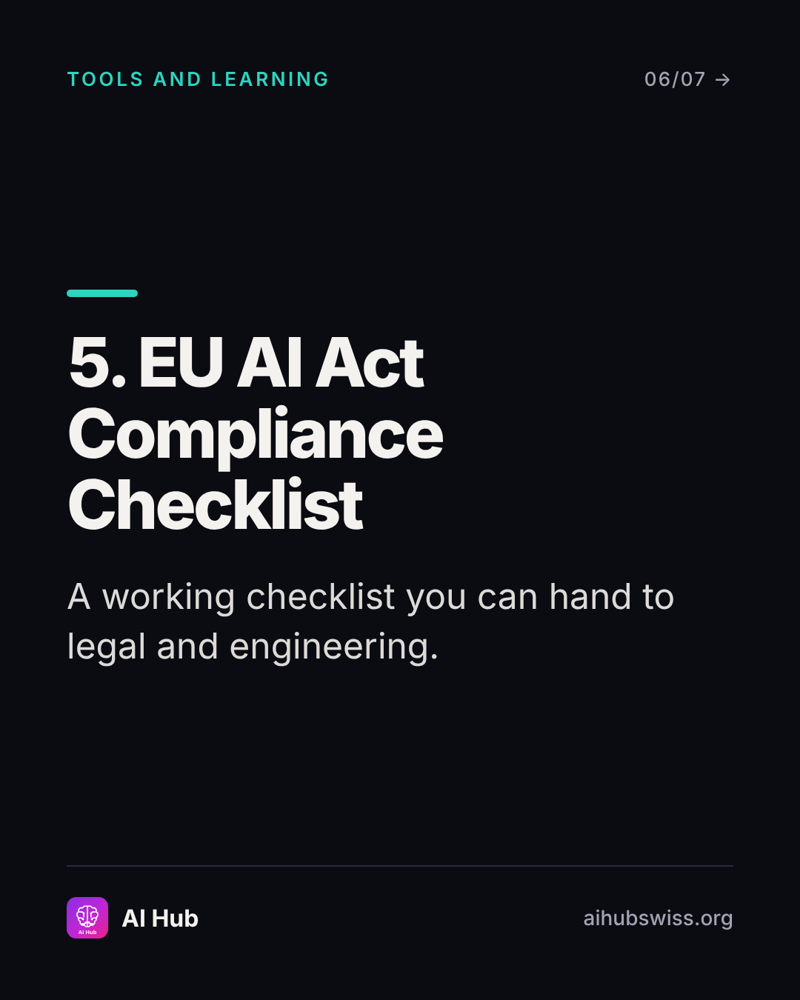
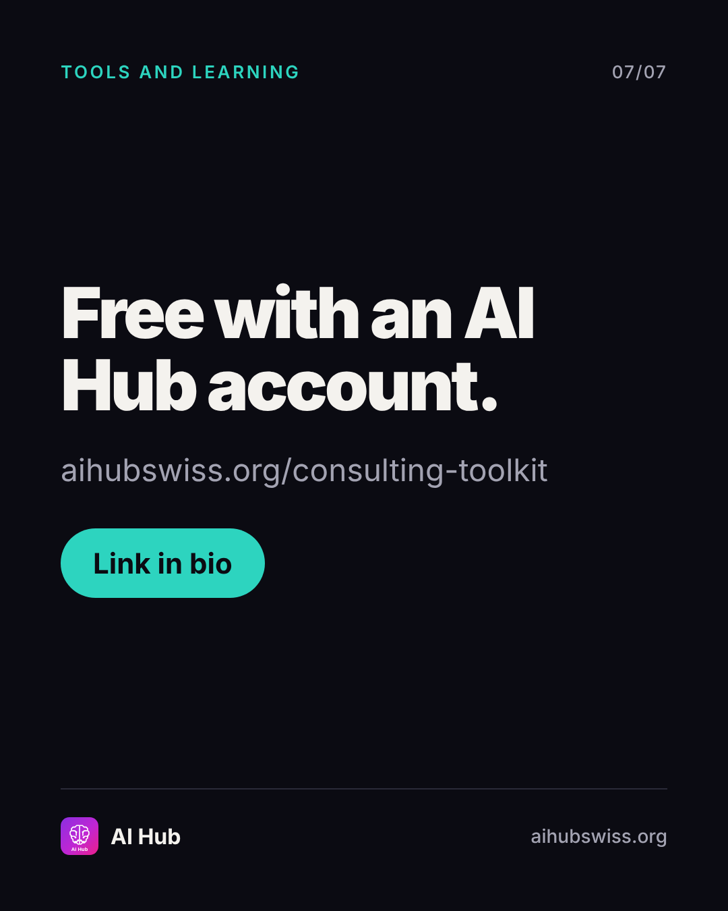

<!-- Generated by design/build-docs.mjs from content/posts.json. Edit the JSON, not this file. -->
# D06 · Mon, 9 Nov 2026 · 12:30 CET: 5 free templates

| | |
|---|---|
| Phase | 2 Demonstrate |
| Pillar | Tools and learning (teal #2DD4BF) |
| Format | carousel |
| Goal | Lead magnet carousel: saves, shares, free account sign-ups |
| Primary action | save |
| DM keyword | `TEMPLATES` |
| Tracked link | https://aihubswiss.org/consulting-toolkit?utm_source=instagram&utm_medium=social&utm_campaign=hub-nov26&utm_content=d06-carousel |

> **Before posting:** Confirm the 42 count and that downloads are still sign-in only (free) before posting.

## Hook
42 AI templates, free. Here are the 5 I'd open first.

## Slides (7), 1080×1350
1. **cover**: FREE TEMPLATES | 42 AI templates. 5 to open first. | Fill-in workbooks, vendor-neutral.  
   
2. **point**: 1. AI Readiness Assessment | Where you stand on data, skills and infrastructure before you start.  
   
3. **point**: 2. Use Case Prioritization Matrix | Business value against feasibility, with a scoring rubric.  
   
4. **point**: 3. Vendor Evaluation Scorecard | Weighted criteria for choosing an AI vendor.  
   
5. **point**: 4. Pilot Project Charter | Scope, success criteria and go/no-go gates for a first deployment.  
   
6. **point**: 5. EU AI Act Compliance Checklist | A working checklist you can hand to legal and engineering.  
   
7. **cta**: Free with an AI Hub account. | aihubswiss.org/consulting-toolkit | Link in bio  
   

## Caption
First line is 90 characters (shows before "…more", keep it under ~125).

```text
AI pilots go wrong fastest when scope, success criteria and ownership aren't written down.

AI Hub has 42 fill-in Excel templates, vendor-neutral and free with an account. These are the five I'd open first, in order.

Save it. Send it to the person who owns your AI roadmap.

Link in bio.
```

## First comment (post within 1 minute)
```text
Comment TEMPLATES and I'll send you the toolkit link.
```

## Hashtags
#AIStrategy #AIGovernance #AIReadiness #Consulting  
Put them at the end of the caption or in the first comment. Keep to 3 to 5.

## Alt text
Carousel listing five free AI templates: readiness assessment, use case matrix, vendor scorecard, pilot charter and EU AI Act checklist.

## Call to action
- Primary: save. Link in bio points to today's tracked link above (also set the Story link sticker).
- DM keyword `TEMPLATES`: reply with the tracked link.

## Story follow-up (same day)
Poll: Which template do you need first? (Readiness / Vendor scorecard / Pilot charter / EU AI Act).

## Facts used and where they come from
- `ai-hub/private/templates/*.xlsx (42 files)`
- `ai-hub/src/app/llms.txt/route.ts (template descriptions)`
- `ai-hub/README.md (signed-in download)`
