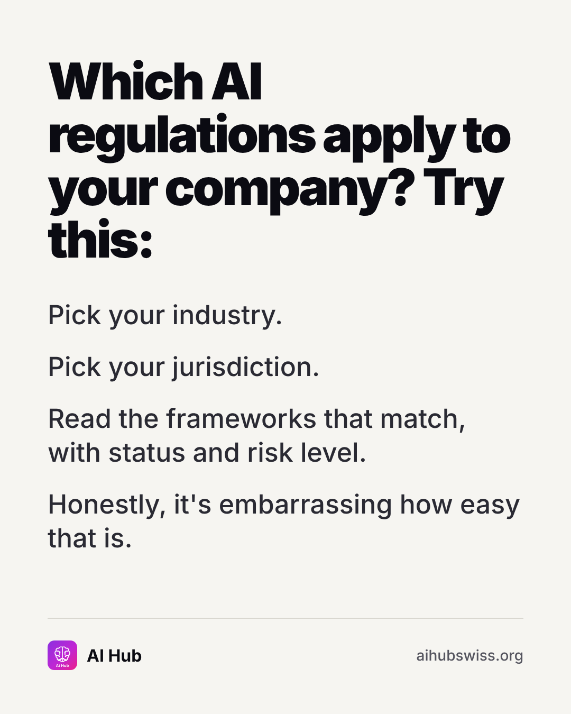

<!-- Generated by design/build-docs.mjs from content/posts.json. Edit the JSON, not this file. -->
# D09 · Thu, 12 Nov 2026 · 18:30 CET: Which rules apply to you (text card)

| | |
|---|---|
| Phase | 2 Demonstrate |
| Pillar | Governance and compliance (amber #FBBF24) |
| Format | textcard |
| Goal | Relatable text card promoting the compliance gate matrix |
| Primary action | send |
| DM keyword | `GATE` |
| Tracked link | https://aihubswiss.org/compliance/gate-matrix?utm_source=instagram&utm_medium=social&utm_campaign=hub-nov26&utm_content=d09-textcard |

> **Before posting:** Click through the filters yourself on the morning of posting so the description matches the live page.

## Hook
Which AI rules apply to your company? It's a filter, not a research project.

## Slides (1), 1080×1350
1. **text**: Which AI regulations apply to your company? Try this: | Pick your industry. / Pick your jurisdiction. / Read the frameworks that match, with status and risk level. / Honestly, it's embarrassing how easy that is.  
   

## Caption
First line is 73 characters (shows before "…more", keep it under ~125).

```text
Working out which AI rules apply to you shouldn't need a week of reading.

AI Hub's compliance gate matrix filters 44 frameworks by industry, jurisdiction, legal status and risk level. It won't replace your counsel, but it tells you which documents to read first.

Send this to whoever owns compliance on your AI projects.

General information, not legal advice.

Link in bio.
```

## First comment (post within 1 minute)
```text
Which jurisdiction matters most to you: EU, Switzerland, UK, US? I'll point you to the right framework page.
```

## Hashtags
#AICompliance #AIGovernance #EUAIAct #RegTech  
Put them at the end of the caption or in the first comment. Keep to 3 to 5.

## Alt text
Text post: pick your industry, pick your jurisdiction, see which AI frameworks apply.

## Call to action
- Primary: send. Link in bio points to today's tracked link above (also set the Story link sticker).
- DM keyword `GATE`: reply with the tracked link.

## Story follow-up (same day)
Poll: Which jurisdiction do you operate in? (EU / Switzerland / UK / US).

## Facts used and where they come from
- `ai-hub/src/components/practitioner/gate-matrix.tsx (filters)`
- `ai-hub/src/data/site-counts.ts (frameworks: 44)`
