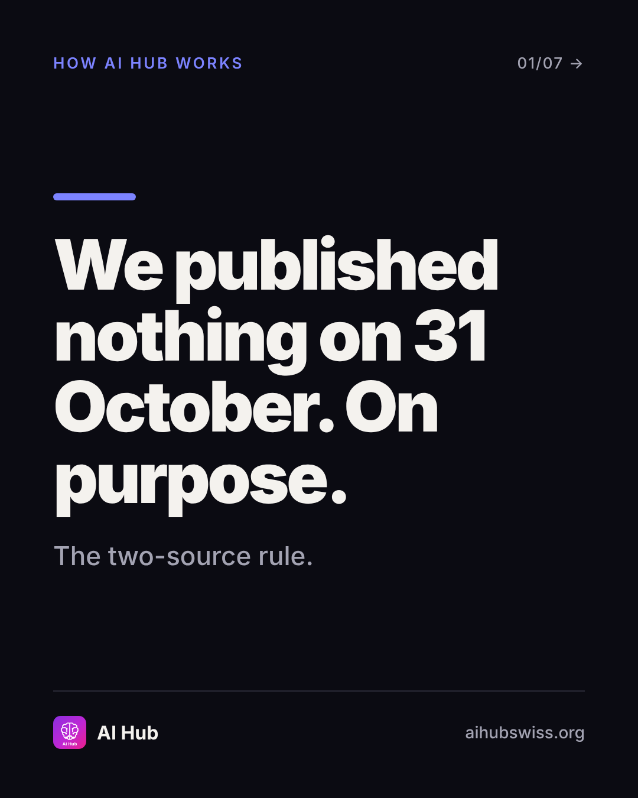
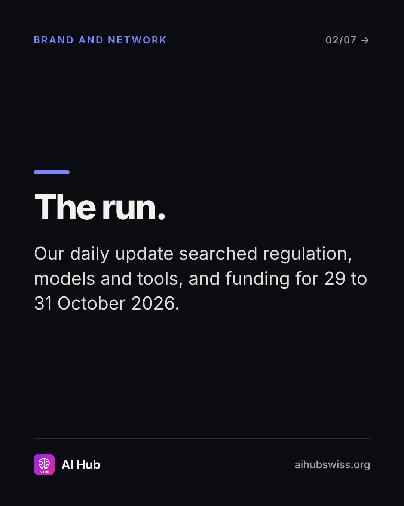
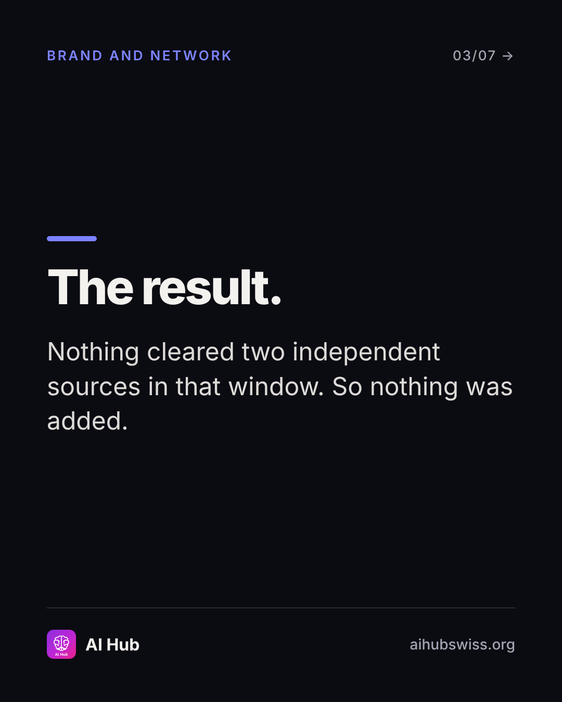
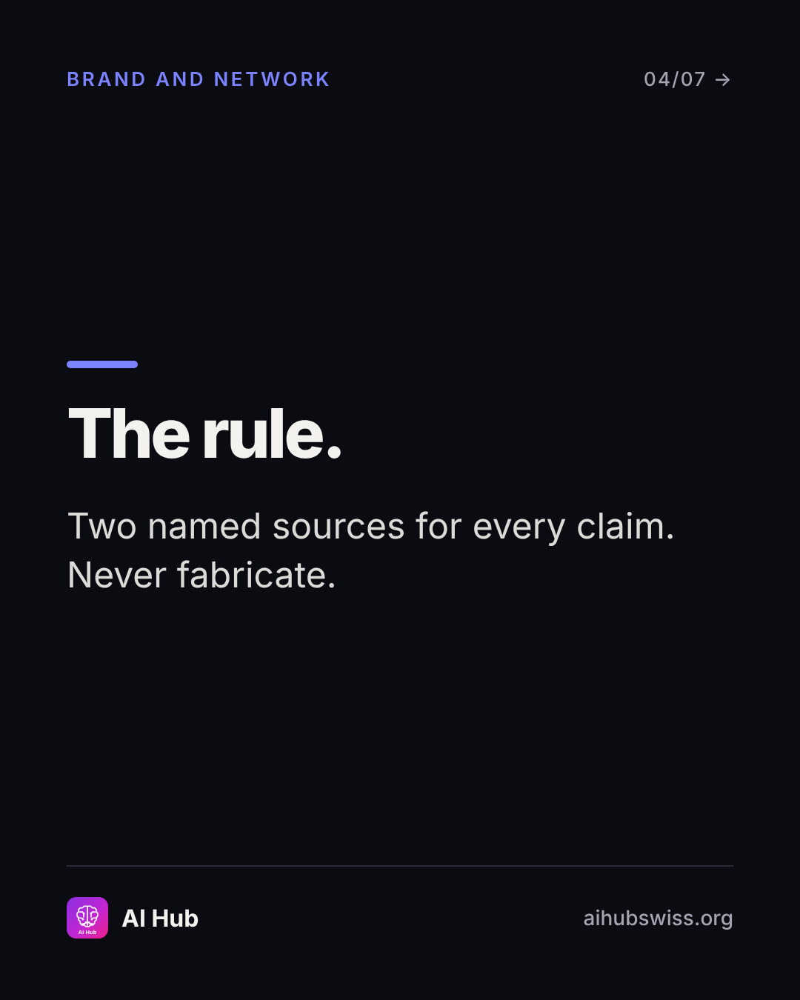
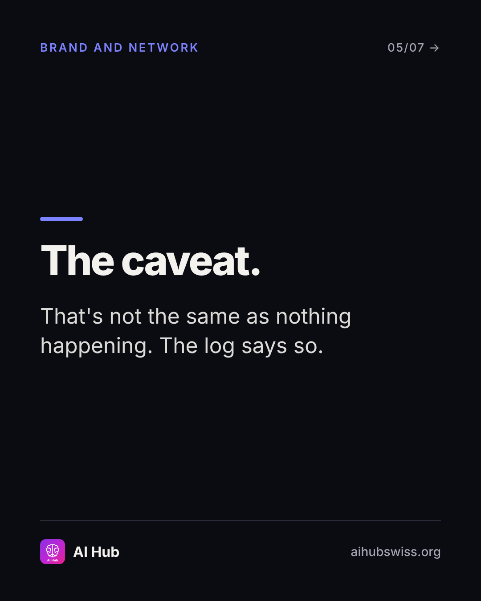
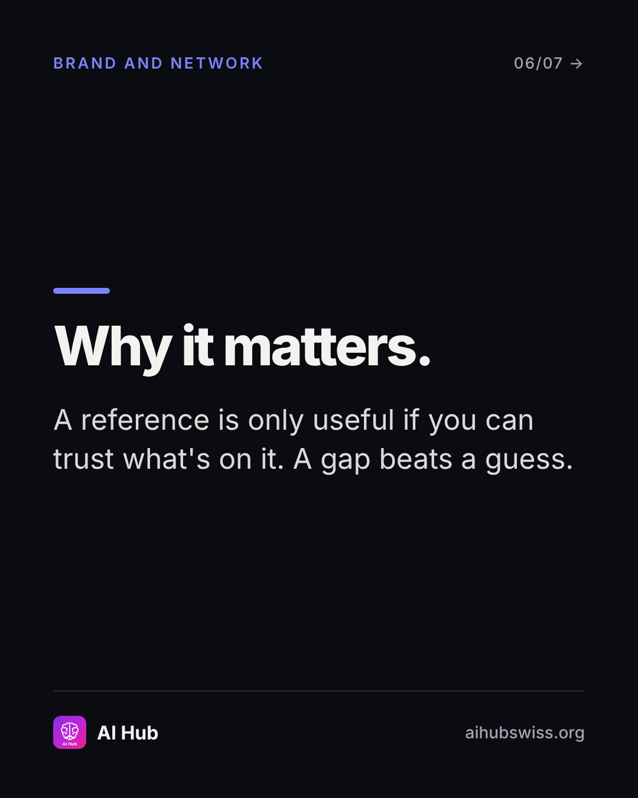
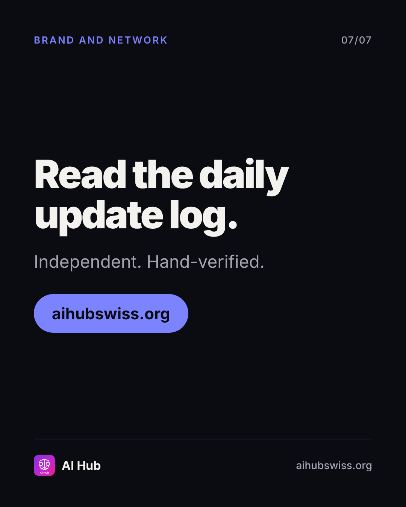

<!-- Generated by design/build-docs.mjs from content/posts.json. Edit the JSON, not this file. -->
# D11 · Sat, 14 Nov 2026 · 10:00 CET: We published nothing on 31 October

| | |
|---|---|
| Phase | 3 Convert |
| Pillar | Brand and network (indigo #7C83FF) |
| Format | carousel |
| Goal | Trust and independence story; shares and follows |
| Primary action | share |
| DM keyword | `TRUST` |
| Tracked link | https://aihubswiss.org/about?utm_source=instagram&utm_medium=social&utm_campaign=hub-nov26&utm_content=d11-carousel |

> **Before posting:** daily-updates.json changes daily. If a newer entry exists, keep this post's 31 October wording exactly as the log states it.

## Hook
We published nothing on 31 October. On purpose.

## Slides (7), 1080×1350
1. **cover**: HOW AI HUB WORKS | We published nothing on 31 October. On purpose. | The two-source rule.  
   
2. **point**: The run. | Our daily update searched regulation, models and tools, and funding for 29 to 31 October 2026.  
   
3. **point**: The result. | Nothing cleared two independent sources in that window. So nothing was added.  
   
4. **point**: The rule. | Two named sources for every claim. Never fabricate.  
   
5. **point**: The caveat. | That's not the same as nothing happening. The log says so.  
   
6. **point**: Why it matters. | A reference is only useful if you can trust what's on it. A gap beats a guess.  
   
7. **cta**: Read the daily update log. | Independent. Hand-verified. | aihubswiss.org  
   

## Caption
First line is 76 characters (shows before "…more", keep it under ~125).

```text
A feed that has to post every day will eventually post something unverified.

On 31 October, our daily update searched regulation, models and tools, and funding, and found nothing dated 29 to 31 October that was backed by two independent sources. So we added nothing, and the log says exactly that.

That's the rule: two named sources for every claim, never fabricate. A gap in a reference is better than a guess.

If you want an AI reference that behaves like this, follow along.

Link in bio.
```

## First comment (post within 1 minute)
```text
Would you rather see a daily post, or a daily post only when it's verified?
```

## Hashtags
#AIGovernance #TrustworthyAI #AILiteracy #Transparency  
Put them at the end of the caption or in the first comment. Keep to 3 to 5.

## Alt text
Carousel explaining why AI Hub published no updates on 31 October 2026: nothing met the two-source rule.

## Call to action
- Primary: share. Link in bio points to today's tracked link above (also set the Story link sticker).
- DM keyword `TRUST`: reply with the tracked link.

## Story follow-up (same day)
Behind-the-scenes: screenshot of the daily update banner. Poll: Verified-only or daily-regardless?

## Facts used and where they come from
- `ai-hub/src/data/daily-updates.json (date 2026-10-31)`
- `ai-hub/README.md (never fabricate, two-source rule)`
