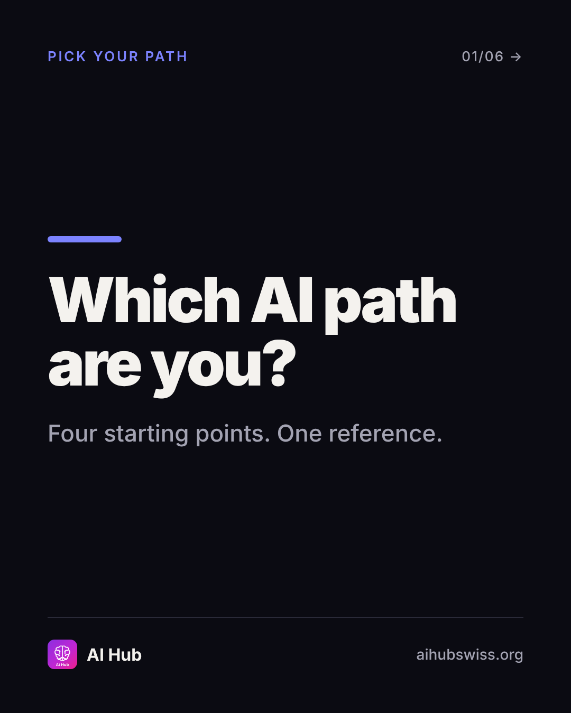
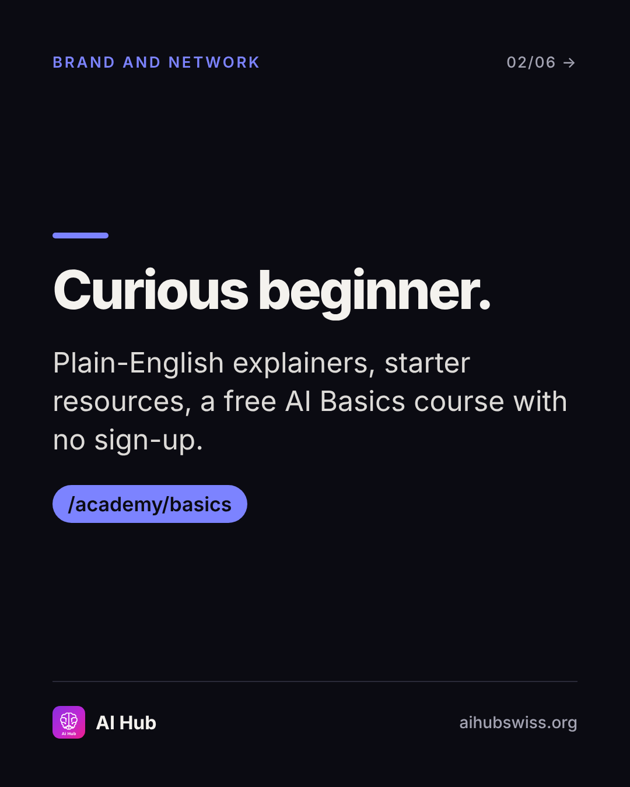
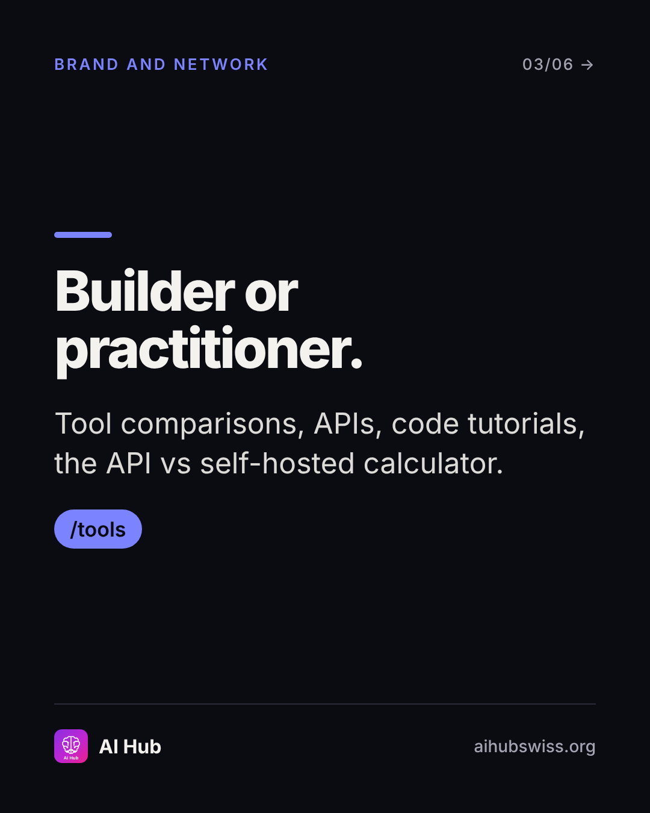
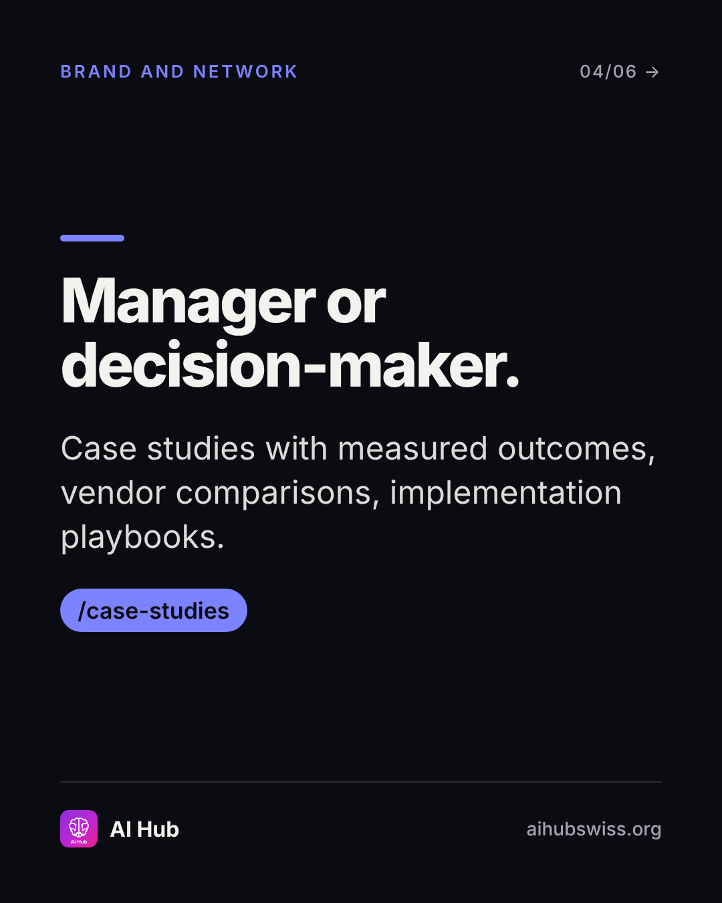
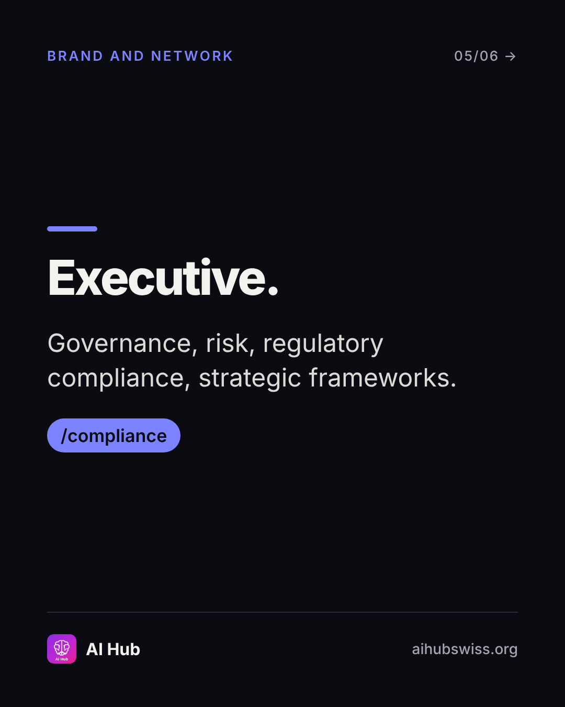
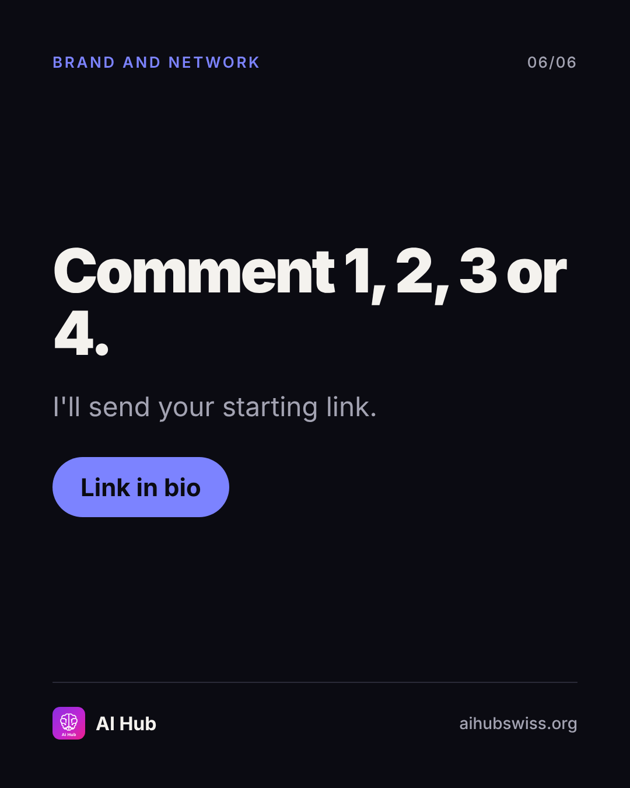

<!-- Generated by design/build-docs.mjs from content/posts.json. Edit the JSON, not this file. -->
# D12 · Sun, 15 Nov 2026 · 18:00 CET: Which AI path are you?

| | |
|---|---|
| Phase | 3 Convert |
| Pillar | Brand and network (indigo #7C83FF) |
| Format | carousel |
| Goal | Interactive, shareable self-segmentation; sends and comments |
| Primary action | comment |
| DM keyword | `1/2/3/4` |
| Tracked link | https://aihubswiss.org/?utm_source=instagram&utm_medium=social&utm_campaign=hub-nov26&utm_content=d12-carousel |

## Hook
Four people. Four ways into AI Hub. Which one are you?

## Slides (6), 1080×1350
1. **cover**: PICK YOUR PATH | Which AI path are you? | Four starting points. One reference.  
   
2. **point**: Curious beginner. | Plain-English explainers, starter resources, a free AI Basics course with no sign-up. | /academy/basics  
   
3. **point**: Builder or practitioner. | Tool comparisons, APIs, code tutorials, the API vs self-hosted calculator. | /tools  
   
4. **point**: Manager or decision-maker. | Case studies with measured outcomes, vendor comparisons, implementation playbooks. | /case-studies  
   
5. **point**: Executive. | Governance, risk, regulatory compliance, strategic frameworks. | /compliance  
   
6. **cta**: Comment 1, 2, 3 or 4. | I'll send your starting link. | Link in bio  
   

## Caption
First line is 75 characters (shows before "…more", keep it under ~125).

```text
Four people open AI Hub on the same morning and need four different things.

1. Curious beginner: start with the free AI Basics course, no sign-up.
2. Builder: tools, APIs, tutorials and the break-even calculator.
3. Manager: case studies, vendor comparisons, playbooks.
4. Executive: governance, risk and compliance.

Comment 1, 2, 3 or 4 and I'll send you the right starting page.

Tag the colleague who's number 4 and doesn't know it yet.

Link in bio.
```

## First comment (post within 1 minute)
```text
1, 2, 3 or 4? And which one is your boss?
```

## Hashtags
#AILiteracy #AIStrategy #AITools #AIGovernance  
Put them at the end of the caption or in the first comment. Keep to 3 to 5.

## Alt text
Carousel: four starting paths into AI Hub for beginners, builders, managers and executives.

## Call to action
- Primary: comment. Link in bio points to today's tracked link above (also set the Story link sticker).
- DM keyword `1/2/3/4`: reply with the tracked link.

## Story follow-up (same day)
Poll with four options (1-4) and link sticker. Reshare best replies.

## Facts used and where they come from
- `ai-hub/src/components/home/persona-selector.tsx`
- `ai-hub/src/app/academy/basics/page.tsx`
