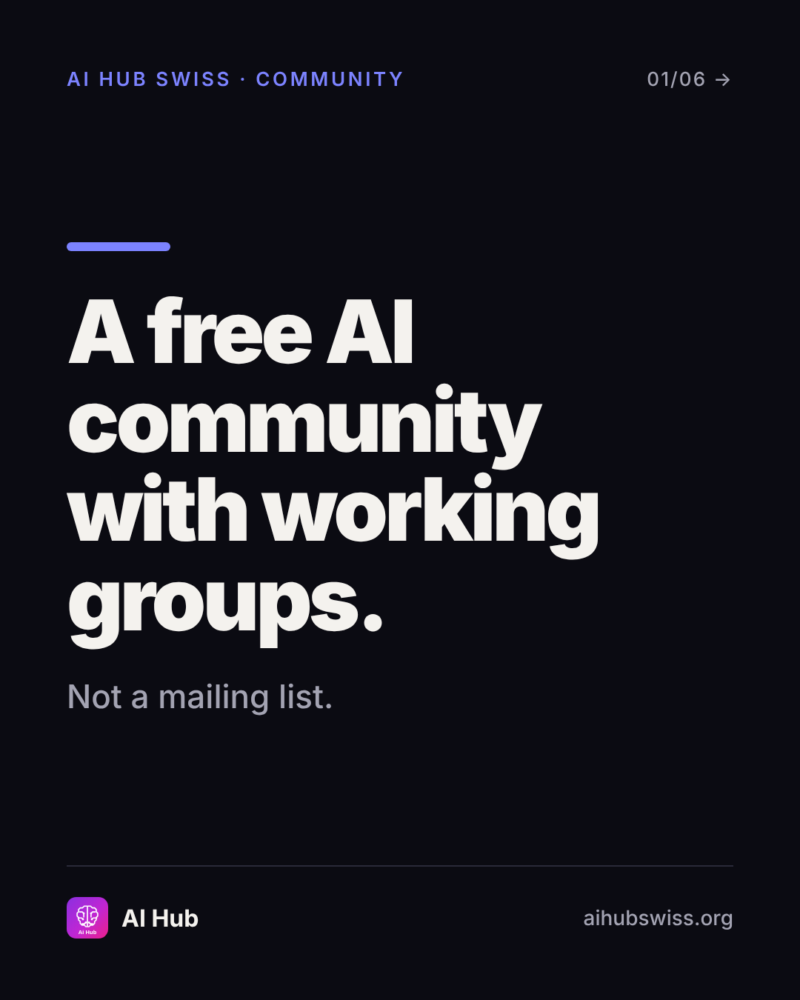
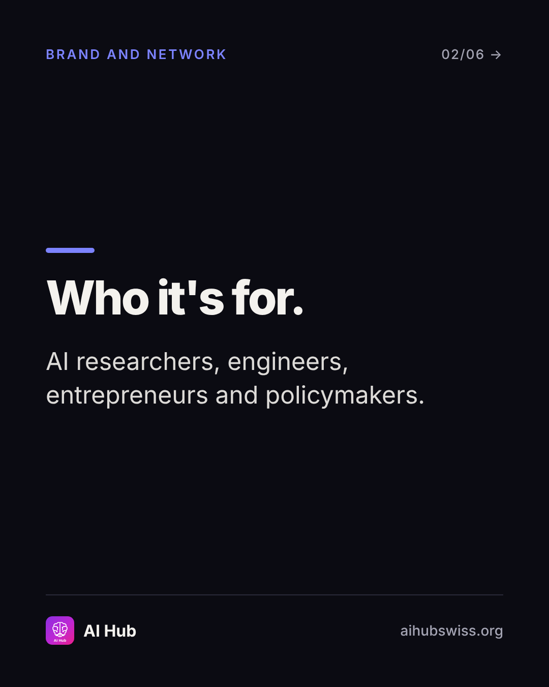
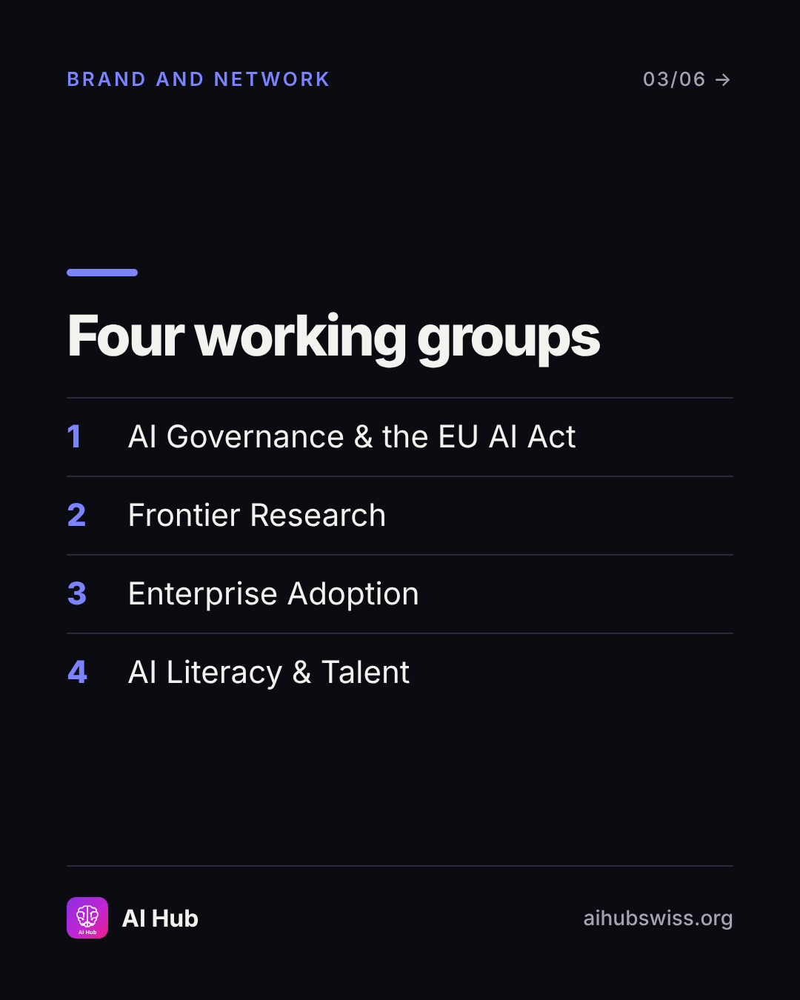
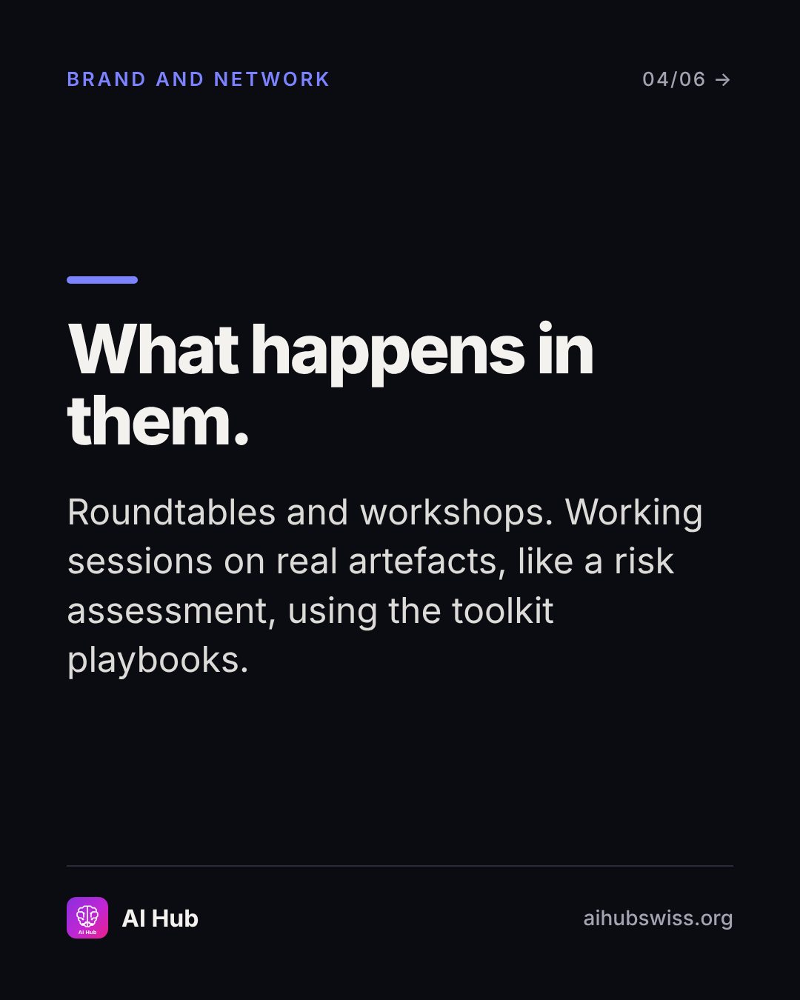
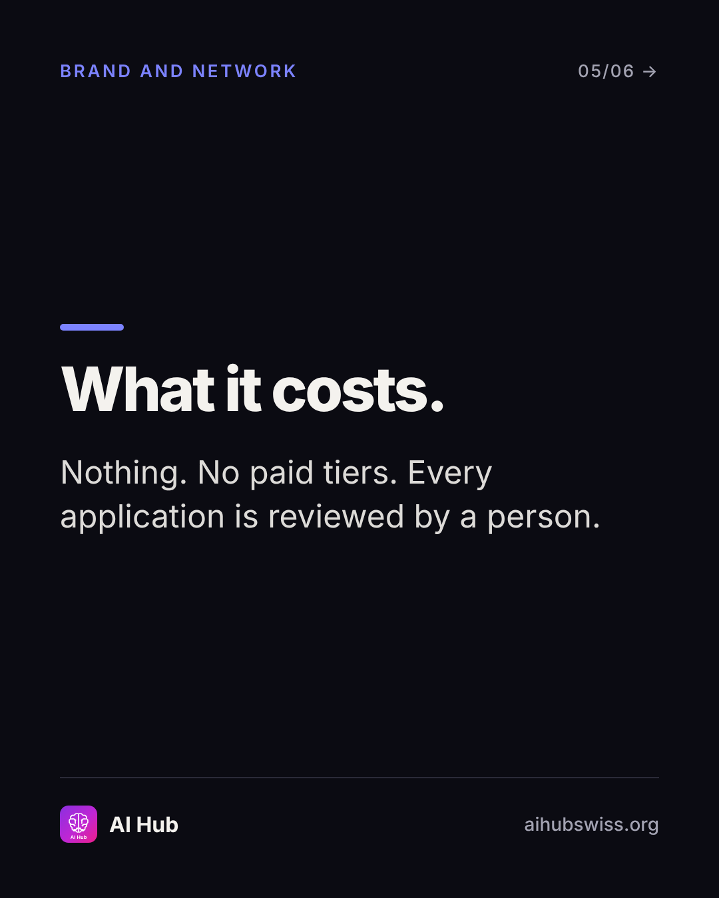
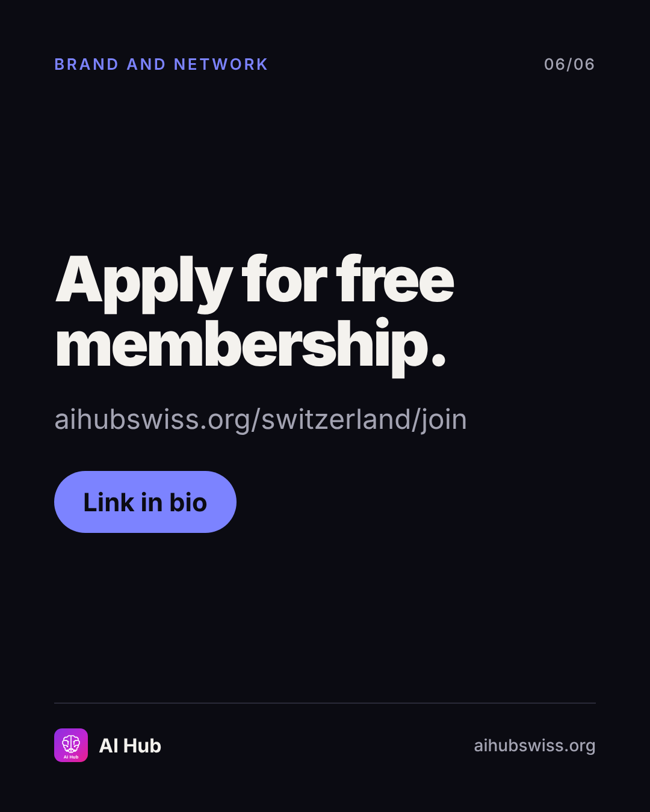

<!-- Generated by design/build-docs.mjs from content/posts.json. Edit the JSON, not this file. -->
# D13 · Mon, 16 Nov 2026 · 12:30 CET: The community

| | |
|---|---|
| Phase | 3 Convert |
| Pillar | Brand and network (indigo #7C83FF) |
| Format | carousel |
| Goal | Free network applications |
| Primary action | link |
| DM keyword | `JOIN` |
| Tracked link | https://aihubswiss.org/switzerland/join?utm_source=instagram&utm_medium=social&utm_campaign=hub-nov26&utm_content=d13-carousel |

## Hook
A free AI community with working groups, not a mailing list.

## Slides (6), 1080×1350
1. **cover**: AI HUB SWISS · COMMUNITY | A free AI community with working groups. | Not a mailing list.  
   
2. **point**: Who it's for. | AI researchers, engineers, entrepreneurs and policymakers.  
   
3. **list**: Four working groups | 1) AI Governance & the EU AI Act / 2) Frontier Research / 3) Enterprise Adoption / 4) AI Literacy & Talent  
   
4. **point**: What happens in them. | Roundtables and workshops. Working sessions on real artefacts, like a risk assessment, using the toolkit playbooks.  
   
5. **point**: What it costs. | Nothing. No paid tiers. Every application is reviewed by a person.  
   
6. **cta**: Apply for free membership. | aihubswiss.org/switzerland/join | Link in bio  
   

## Caption
First line is 70 characters (shows before "…more", keep it under ~125).

```text
A chat group with thousands of people and no agenda isn't a community.

AI Hub Swiss is a free practitioner community built around four working groups: AI governance and the EU AI Act, frontier research, enterprise adoption, and AI literacy and talent. Roundtables, workshops and working sessions on real artefacts.

No fee, no paid tiers. Every application is reviewed by a person.

Apply at the link in bio.
```

## First comment (post within 1 minute)
```text
Which working group would you join first?
```

## Hashtags
#AICommunity #AIGovernance #Switzerland #ResponsibleAI  
Put them at the end of the caption or in the first comment. Keep to 3 to 5.

## Alt text
Carousel introducing the free AI Hub Swiss community and its four working groups.

## Call to action
- Primary: link. Link in bio points to today's tracked link above (also set the Story link sticker).
- DM keyword `JOIN`: reply with the tracked link.

## Story follow-up (same day)
Poll: Which working group? Link sticker to join page.

## Facts used and where they come from
- `ai-hub/src/app/switzerland/network/page.tsx`
- `ai-hub/src/app/switzerland/join/page.tsx`
