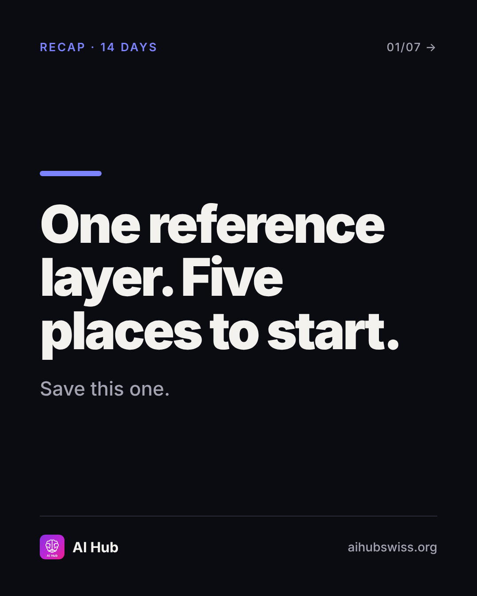
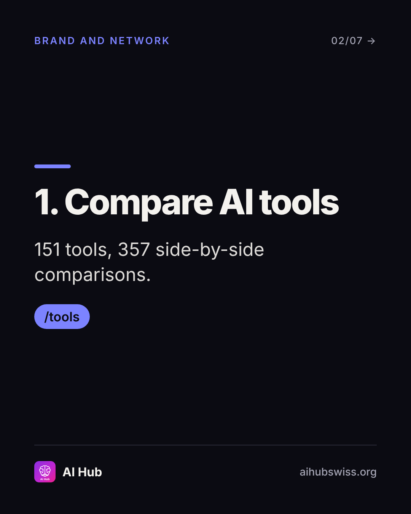
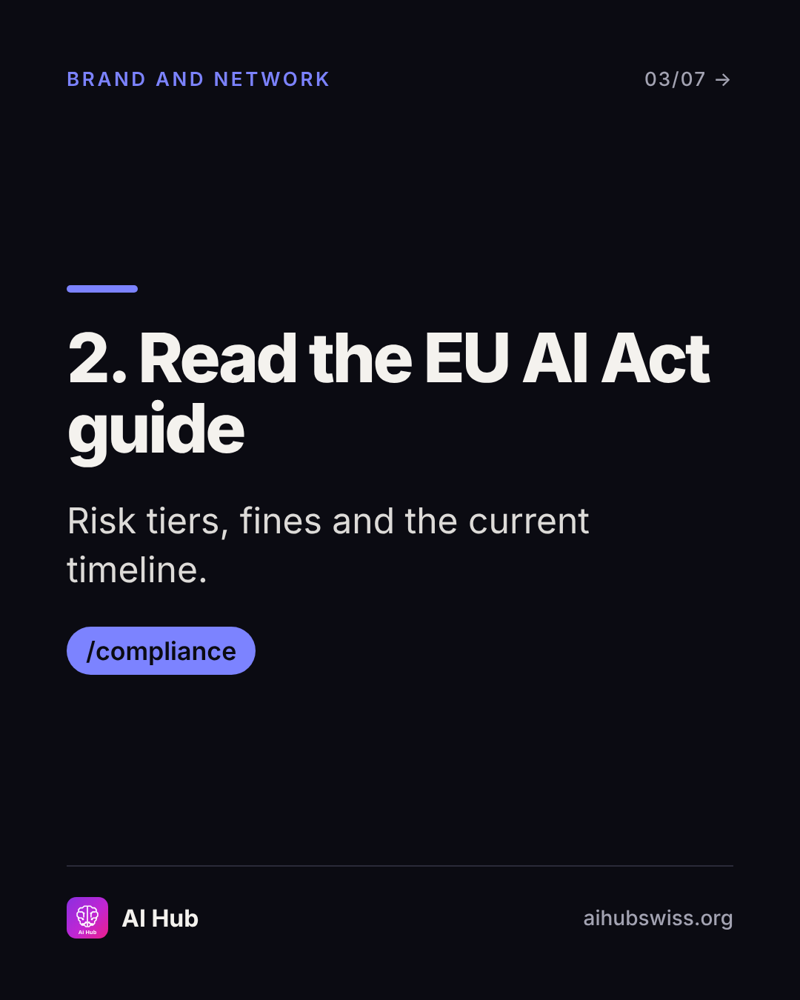
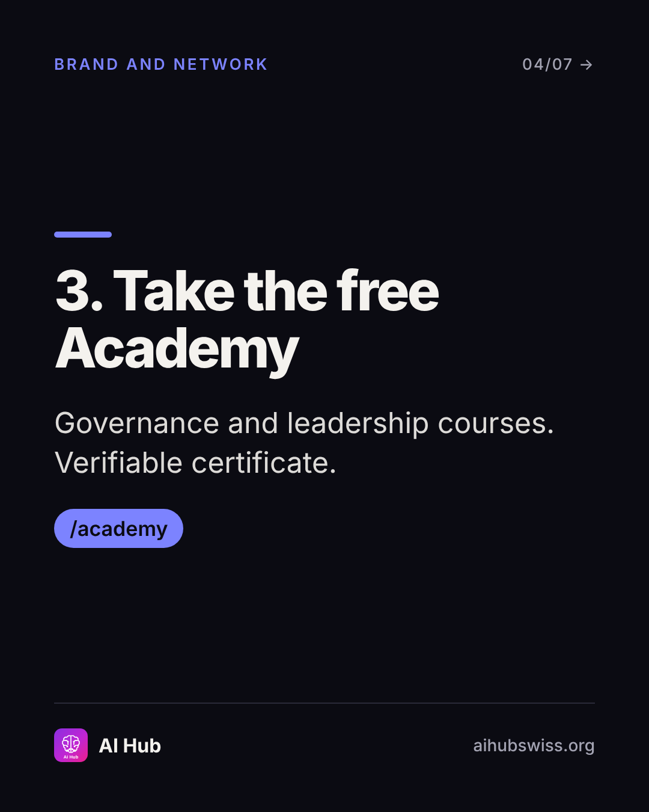
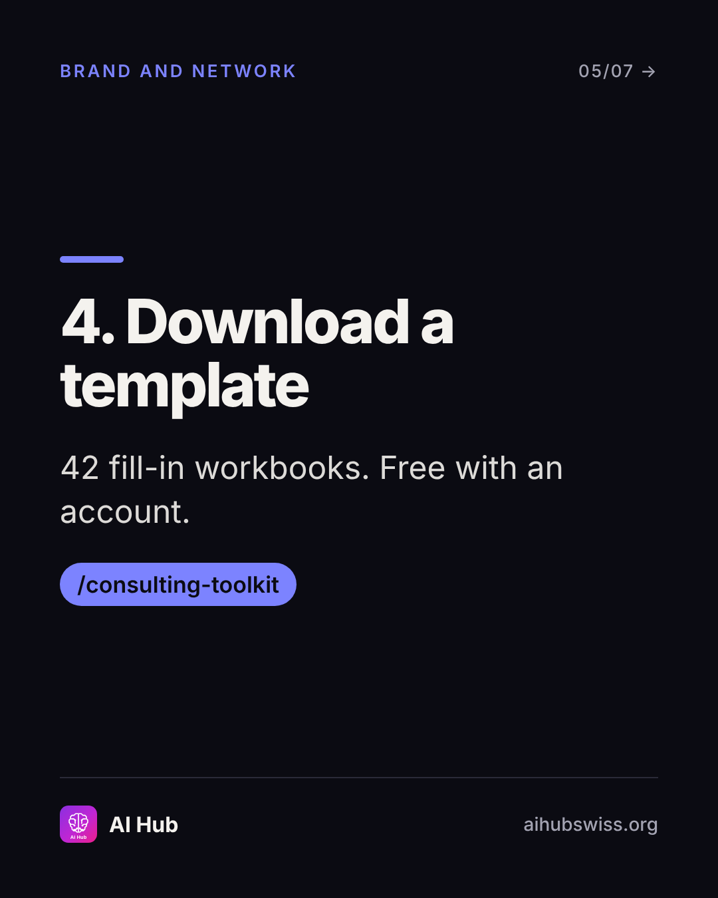
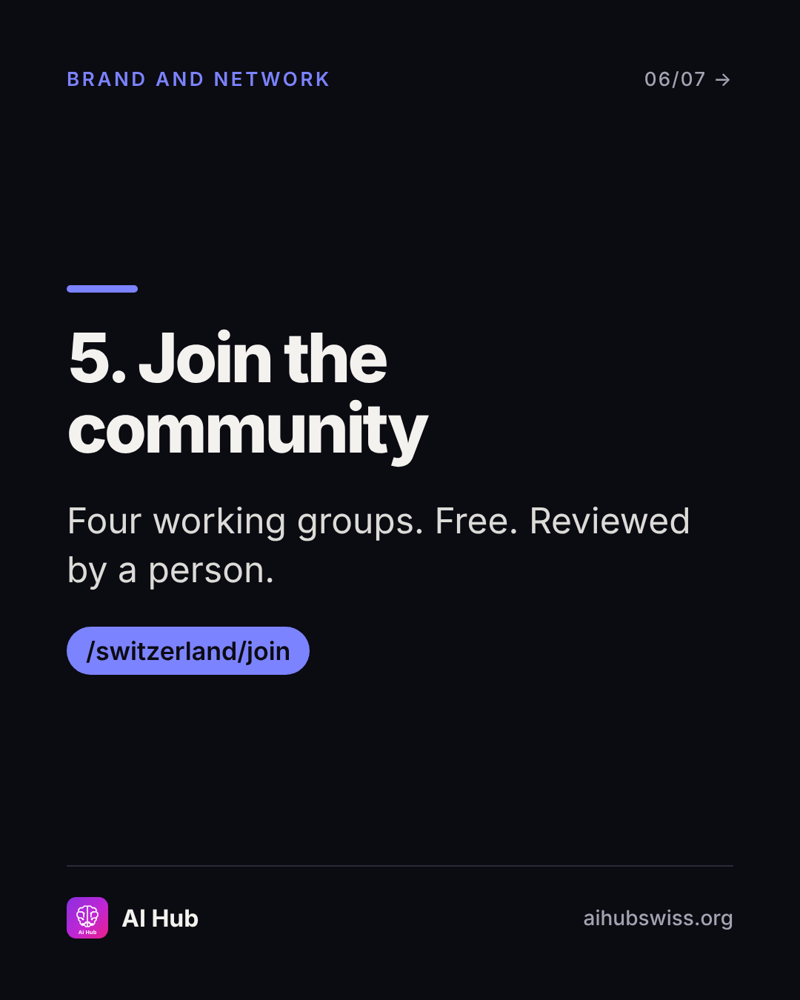
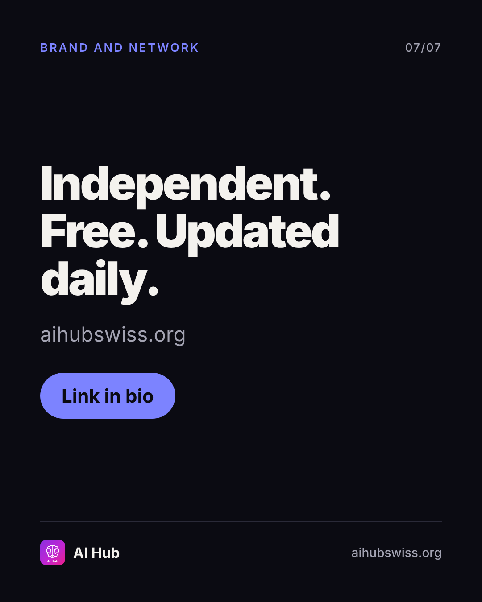

<!-- Generated by design/build-docs.mjs from content/posts.json. Edit the JSON, not this file. -->
# D14 · Tue, 17 Nov 2026 · 12:30 CET: Recap: 5 places to start

| | |
|---|---|
| Phase | 3 Convert |
| Pillar | Brand and network (indigo #7C83FF) |
| Format | carousel |
| Goal | Recap and conversion; saves |
| Primary action | save |
| DM keyword | `HUB` |
| Tracked link | https://aihubswiss.org/?utm_source=instagram&utm_medium=social&utm_campaign=hub-nov26&utm_content=d14-carousel |

## Hook
Two weeks, one reference layer. Five places to start.

## Slides (7), 1080×1350
1. **cover**: RECAP · 14 DAYS | One reference layer. Five places to start. | Save this one.  
   
2. **point**: 1. Compare AI tools | 151 tools, 357 side-by-side comparisons. | /tools  
   
3. **point**: 2. Read the EU AI Act guide | Risk tiers, fines and the current timeline. | /compliance  
   
4. **point**: 3. Take the free Academy | Governance and leadership courses. Verifiable certificate. | /academy  
   
5. **point**: 4. Download a template | 42 fill-in workbooks. Free with an account. | /consulting-toolkit  
   
6. **point**: 5. Join the community | Four working groups. Free. Reviewed by a person. | /switzerland/join  
   
7. **cta**: Independent. Free. Updated daily. | aihubswiss.org | Link in bio  
   

## Caption
First line is 37 characters (shows before "…more", keep it under ~125).

```text
Two weeks of posts, one page to keep.

If you save one thing from this campaign, save this: five places to start on AI Hub.

1. Compare AI tools
2. Read the EU AI Act guide
3. Take the free Academy
4. Download a template
5. Join the community

Independent, free, updated daily. What should we build or cover next? Tell me in the comments.

Link in bio.
```

## First comment (post within 1 minute)
```text
What's missing from AI Hub that you'd use every week? Best answers shape the next update.
```

## Hashtags
#AIGovernance #AITools #AILiteracy #ResponsibleAI  
Put them at the end of the caption or in the first comment. Keep to 3 to 5.

## Alt text
Recap carousel: five places to start on AI Hub, from tool comparisons to the free community.

## Call to action
- Primary: save. Link in bio points to today's tracked link above (also set the Story link sticker).
- DM keyword `HUB`: reply with the tracked link.

## Story follow-up (same day)
Highlight reel of the 14 days. Question sticker: What should AI Hub cover next?

## Facts used and where they come from
- `ai-hub/src/data/site-counts.ts`
